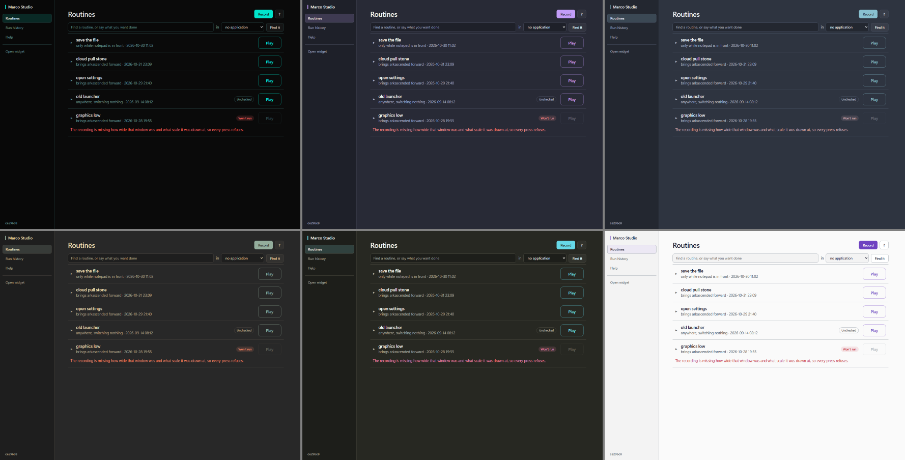
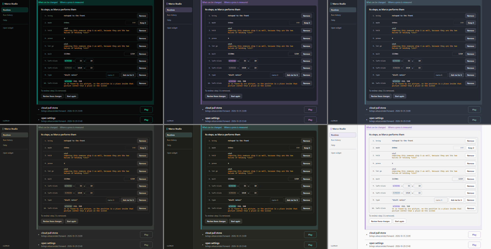
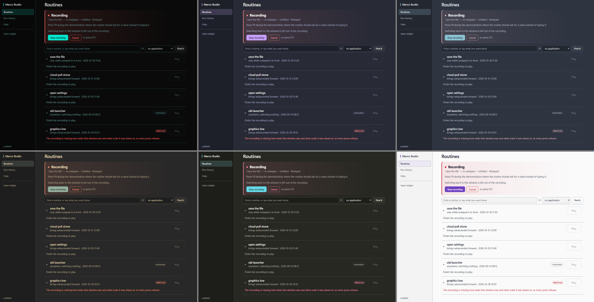
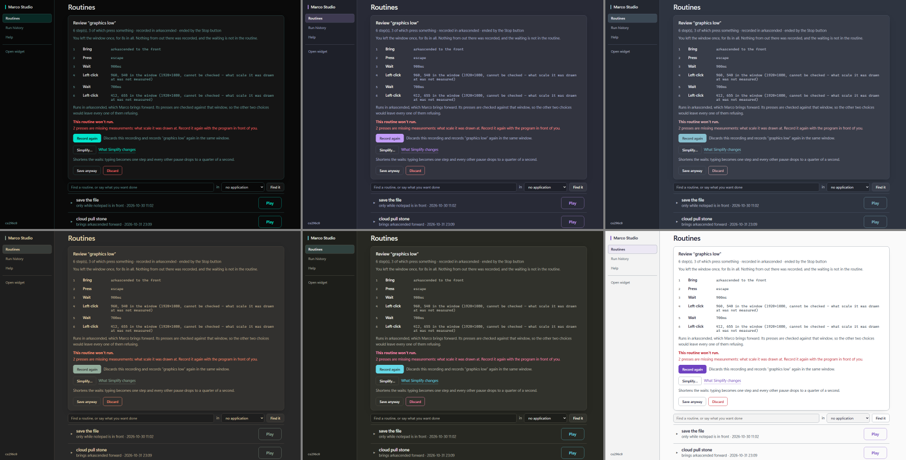
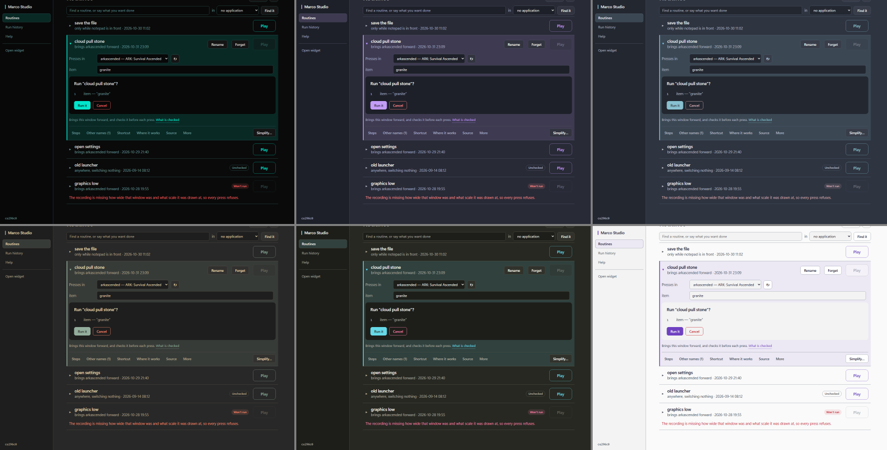

# Shared styling and themes: the mapping, rendered first

The follow-on to [[Surfaces-alignment-proposal-2026-11-02]] after S0–S9. Studio takes the
widget's theme choice and palettes. No new theme system: the widget's ten palettes and its one
`theme` setting (S5, `internal/widgetconfig`) are the only source. Built as
[[ADR-307-studio-draws-the-widgets-theme]].

## What existed

- **The widget** (`plugins/overlay/view.go`): ten palettes of eleven colours each:
  `bg name cmd lastCmd sep desc idle listen run errc logInfo`. It picked one by `theme`
  (`themeByName`, falling back to `default`). The settings panel cycles the same ten names.
- **The setting:** `widgetconfig.Settings.Theme`, read and written through S5's one owner. The
  control centre's Config view offers the same ten names.
- **Studio** (`frontend/index.html`): its own token set on `:root` (`--ground --raise --sink
  --line --ink --dim --faint --spot --spot-ink --spot-dim --ok --warn --no`, their `-bg` tints,
  and `--lift`). It had a dark and a light variant chosen by the OS. Every colour on the page
  goes through these tokens, so a theme is one token set and the layout does not change.

## The owner's rulings (2026-11-04)

1. **Studio follows the shared palette, including `default`.** The widget's default dark palette
   replaces OS-selected light or dark. The explicit `light` palette stays available. There is no
   separate Studio theme preference.
2. **Warning amber stays a Studio semantic colour**, adjusted for readability on each palette
   while keeping its warning meaning.
3. **The accent fallback is approved for the existing catalogue.** The `listen` fallback must be
   checked too, because changing roles alone does not establish distinction or contrast. The 30°
   rule is a heuristic, not an accessibility guarantee.
4. **Correction: 3:1 is not enough where the accent is ordinary text**, such as outlined Play
   labels and links. Test the actual foreground and background pairs, including raised cards,
   tinted banners, primary-button text and focus indicators. Keep labels and other non-colour
   state cues.
5. The widget's palette values stay unchanged. Unknown names resolve through the existing
   default behaviour.
6. A setting changed outside the widget still needs a widget restart where live reload is
   unsupported. Do not claim both surfaces update live.

## The mapping, as built (`widgetconfig.StudioTokens`)

| Studio token | from the widget palette | floor |
|---|---|---|
| `--ground` | `bg` | — |
| `--raise` | `bg` 5% toward `cmd` (white on a light palette) | — |
| `--sink` | `bg` 25% toward black (3% on light) | — |
| `--line` | `sep` | 1.6:1 on ground |
| `--ink` | `cmd` | 7:1 on ground, card and field; 4.5:1 on every tint |
| `--dim` | `desc` | 4.5:1 on every surface |
| `--faint` | `lastCmd` | 4.5:1 on every surface |
| `--spot` (accent) | `name`, or `listen` when `name` is within 30° of hue of ok, warning or refusal | 4.5:1 on every surface (was 3:1 in the proposal) |
| `--spot-ink` (label on the accent) | `bg` | 4.5:1 on the accent and on `--ink` (hover) |
| `--ok` | `run` | 4.5:1 on every surface |
| `--no` | `errc` | 4.5:1 on every surface |
| `--warn` | Studio's amber (`#e3a73c`, or `#8f5f07` on light), kept within 12° of that hue | 4.5:1 on every surface |
| `-bg` tints | 14% of each over `bg` (10% on light) | — |

- "Every surface" is the ground, a raised card, a sunken field and the four tints (`--spot-bg`,
  `--ok-bg`, `--warn-bg`, `--no-bg`).
- A colour that falls short is moved toward `--ink` until it passes. The tints depend on the
  colours, so the two are iterated until nothing moves.
- Light or dark is decided by the palette's background, not by the OS.
- The proposal's JavaScript mapping is gone. The page now applies what Go returns.
- Two fixed whites on the page became tokens: the text selection, and the Stop button's hover
  label.

The resulting token sets are in `images/studio-ui/themes/s10-tokens.json`, generated from
`StudioTokens`.

## Renders (after implementation)

These are the real page through the existing harness (`9-harness` fixtures and states), with
`Theme` answering the Go mapping's own tokens. They are not a desktop run. Each sheet is six
palettes: top row default, dracula, nord; bottom row gruvbox-dark, monokai, light.

| state | sheet |
|---|---|
| library |  |
| step editor |  |
| recording |  |
| review with a refusal |  |
| run confirmation |  |

### Measured pairs on the rendered page

`images/studio-ui/themes/s10-contrast-audit.js` measures every visible text node against the
background it is actually drawn on. That background is the ancestors' backgrounds composited in
order, with a parent's opacity applied to both the text and its backdrop. The audit ran over all
ten palettes and all five states (50 renders), and the results are in
`images/studio-ui/themes/s10-contrast.txt`.

- **No enabled text under 4.5:1** in any of the 50. The lowest was 4.54:1 (solarized-dark's
  accent "What can be changed" on the chosen-row tint). The refusal "Won't run" pill measured
  4.67–5.6:1.
- **No page errors** in any render.
- **Disabled Play** measured 2.08–2.36:1 across palettes. Studio's own dark tokens before this
  change measured 2.11–2.14:1 in the same states, so this is the level it already had. The label
  "Play" and the reason beside it ("Finish the recording to play", "Won't run") carry the state.
  WCAG exempts disabled controls, and nothing here claims they meet a contrast floor.
- The equivalent measurement of Studio's old light stylesheet did not apply in that run and is not
  cited.

### What the renders established

- The layout is unchanged in every palette.
- The refusal red, the disabled Play, the recording banner, the focus and primary accent, and the
  warning lines stay distinct and labelled.
- The first render-first pass found two accent collisions: gruvbox-dark's accent (#FE8019) is
  nearly the warning amber, and monokai's (#A6E22E) is its own success green. Both now take
  `listen`. Their fallbacks were measured too: gruvbox's `listen`, lifted to #93ad9c, is 80° from
  its ok, and monokai's #66d9e8 is 107° from its ok.

## Found, and not changed

- **ok and warning, and refusal and warning, can share a hue.** In gruvbox-dark the palette's own
  ok is 23° and its refusal 25° of hue from the amber. In solarized-dark the ok is 29° from it.
  The rulings keep both the palette values and the amber, so the labels distinguish these states
  and the colour alone does not.
- **The widget does not reload its settings.** It reads `overlay.json` at launch and applies at
  once only a change made in its own panel. A theme changed in the control centre or in the file
  reaches an open Studio within ten seconds, and the widget only when it restarts.
- **The harness's compiled executable** (`h.exe`) disappeared from the scratchpad during the
  render-first pass. **The cause is unknown**: nothing was found to show antivirus removed it. The
  renders used a script that injects the same files into the page and drives Edge directly.

## Verification (Windows only, affected checks)

Outputs are in `docs/experiments/Roadmap-38-output/2026-11-04-s10-*.txt`.

- `go build ./...`, `go vet` of `internal/widgetconfig`, `cmd/marco` and `plugins/studio`, and
  docscheck all passed. Binaries were unchanged.
- `internal/widgetconfig`, `plugins/overlay` (all packages) and the `cmd/marco` control-centre
  tests passed.
- **The first Studio run failed**: `TestTheShortcutTabDoesWhatItShows` reported "the page
  threw". Its stub (`testdata/shortcutspage.js`) had no `Theme`, so the new call threw. That is
  the harness's guard against an unstubbed binding, working. The stub was added, and the second
  full Studio run passed.
- The full engine suite was not run.
- Each new guard was mutated; every mutant was killed except removing the page's `.catch` on a
  failed theme answer, which only silences an unhandled rejection.

## Not established

- No desktop render. Wails's WebView2 should match Edge, which drew these, but that is not
  established.
- Windows only.
