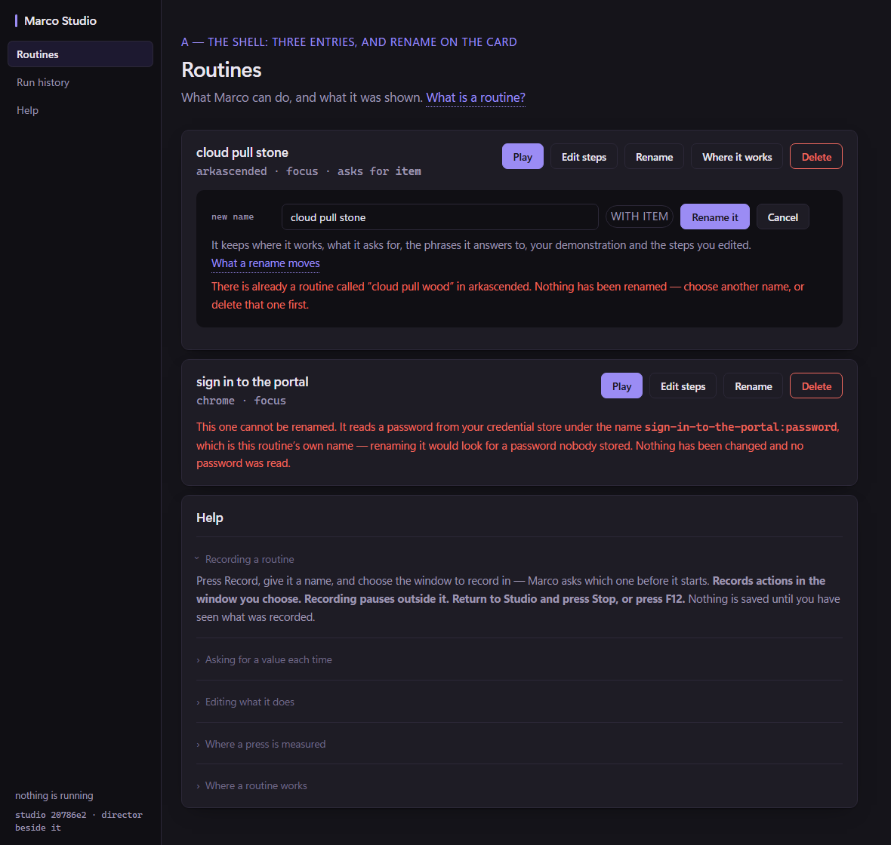
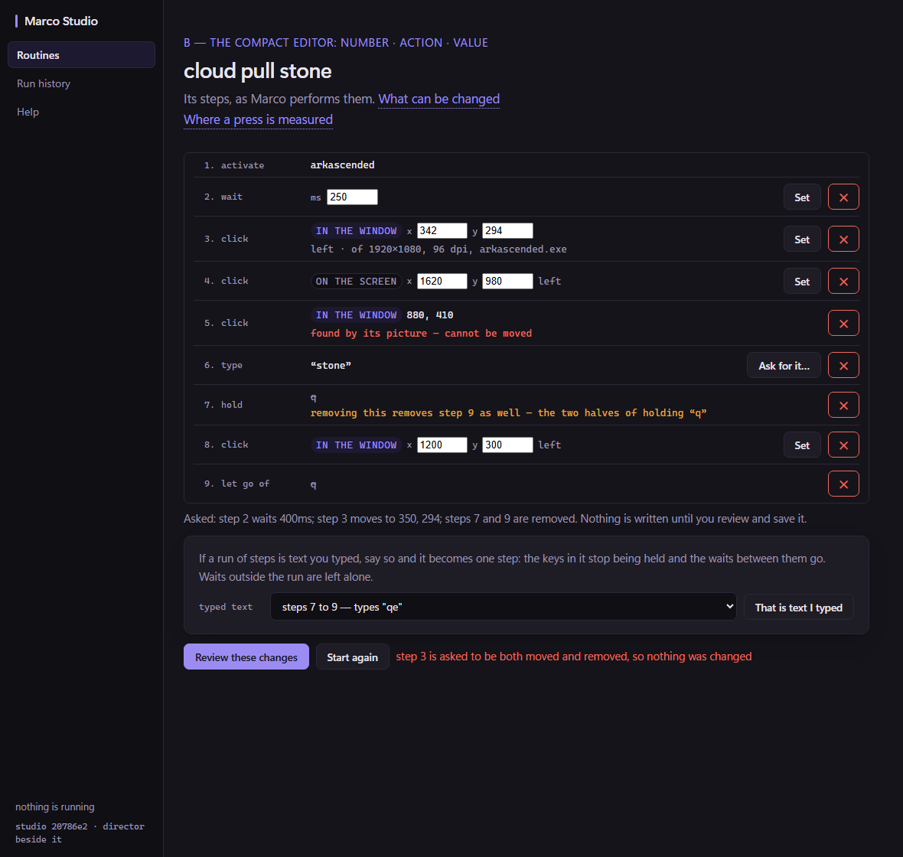

# The alpha UI slice: one journey, a compact editor, rename, and a point that can be moved

Traced at `20786e2`, proposed with the two rendered layouts below, and approved by the Architect
with four decisions and five amendments. **Four slices, in this order.** Each is separately
reviewable.

> The UI still feels clunky. The idea is to remove some of the text by adding a help section,
> acts and scenes get hidden since we don't support them right now, and the edit screen gets a
> facelift + usabilty
>
> — the owner

## The layouts



Three rail entries. Rename inline on the card, with the clause that declares an argument shown
beside the box and **not editable**. The second card is the case rename refuses. Help is one
section; every sentence in it that names a shortcut comes from the backend.



Four columns — number · action · value · controls. The basis is a badge rather than a sentence.
No paragraph sits on a monospace row; the refusals and the pair warning do, because they are what
somebody is about to act on.

Both are rendered against Studio's own stylesheet in headless Edge, at 1180px. They are
PROPOSALS, not screenshots of the product: nothing in the second layout exists yet.

## What was traced first

### Coordinates

Three step kinds carry points — `StepClick`, `StepDrag`, `StepMove`. A press measured inside a
window carries ADR-250's five terms, and **their presence is the opt-in** for the guarded
contract. From the owner's own routine:

```
the p1 is a Point with X 342, Y 294, RelX 342, RelY 294, RelTo "window",
                       WinW 1920, WinH 1080, Dpi 96, Process "arkascended.exe".
```

The fact that makes a coordinate editable at all: the absolute point and the relative offset were
measured **at the same instant**, so the window origin is recoverable as `(X-RelX, Y-RelY)`.
Editing the offset can therefore move the screen point with it, from the same measurement —
nothing is invented and no new reading is taken. Without that, editing either number makes the
other one a lie.

A click that carries `Template`, `Color`, `AnchorText` or `AnchorVision` must refuse: its
`AnchorClickX/Y` is a position INSIDE a picture, so moving the point re-aims the picture at
somewhere else.

### Rename

Nothing renames today. `Deps.Rescope` (`internal/orchestrator/rescope.go`) is already the whole
move engine: deterministic two-route lock ordering, revalidation of the source, recording, aliases
and steps digests **at both ends**, version-bound collision consent, exclusive asset writes, the
destination read back **before** the original is removed, and it carries the recording, the steps
account rebound to the new source digest, and the aliases rebound to the new route. Rename is that
engine with a destination that differs by **slug** rather than by application or scope.

Two things bite:

1. **The name is where the arguments are declared** (`routes.SplitArgs` on
   `cloud pull stone with item`), so a free-text rename box is a way to silently drop one.
2. **A declared secret is route-qualified** — `codegen.typeSentence` emits
   `do OS's Secret with "<route>:password"`, and its own comment says what disagreeing about that
   costs: *looking up a secret nobody stored*. Re-rendering under a new name would move the
   credential name, so that case is REFUSED rather than performed. Nothing reads or migrates a
   credential.

### The shell

`paintViews` walked a hardcoded `['routines','acts','scenes','history']` and touched
`$('rail-' + v)`. Remove a button and the page throws mid-paint and stops rendering **entirely**
— so the elements stay in the document and the LIST comes from the backend.

### Help

None existed. 82 `muted` blocks in the page, 22 of them in the Routines view. But
`everywhereSentence` and `argSentence` name **F12 and F9 read from the environment**, so those
sentences cannot become static help text without reintroducing the exact two-readings defect that
already shipped on the record card once.

## The Architect's decisions

| | |
| --- | --- |
| **Rename** | Arguments as a non-editable chip; the box edits only the name. Preserve scope, aliases, demonstration and stored steps. A reviewed move. Collisions refused — **no overwrite option**. |
| **Coordinates** | Edit window-relative X/Y for measured clicks, deriving the screen point from the recorded origin. For unmeasured points, edit screen X/Y. **One** editable pair, clearly labelled; derived values may be read-only. |
| **Drags** | Out of this slice. Anchored clicks stay non-editable with a short reason. |
| **Flags** | Environment flags, read **once at Studio startup**, default off for Acts and Scenes. No settings UI or runtime toggle. Hidden views must not break navigation or keep unnecessary polling active. |

And five amendments to the layouts, applied to the renders above:

1. No explanatory prose in the editor's monospace rows — the coordinate paragraph moves into
   Help. The basis badge, the values and a short refusal stay on the row. X/Y fields get explicit
   labels and the remove buttons get accessible names.
2. Fix the struck-through pair warning: strike only the removed action and value; the explanation
   stays readable. (A real defect in today's page, not only in the mock — `.pair` is a child of
   `.what`, and `text-decoration` reaches every descendant and cannot be taken off one.)
3. Correct Help's recording claim: it records **the window explicitly chosen beforehand**, not
   "the window you go to". Use the configured shortcut values.
4. Rename preserves behaviour, including route-qualified secret lookups; where preservation is
   unsupported, refuse that case explicitly.
5. A changed point keeps its button, its modifiers and every guard term. Incomplete measurements
   and invalid relative positions are refused rather than completed — **don't manufacture a
   guarded point.**

Carried forward unchanged: the displayed-list basis, the review token and the stale-source
protections, now also for coordinate edits; and the move engine's read-back and
original-retention guarantees for rename.

## The four slices

| | What it touches | What it refuses |
| --- | --- | --- |
| **1 — Flags and Help** | `Acts.Features`, `Acts.Help`, the rail, `paintViews`, `show`, the startup polls | a view that is not offered |
| **2 — The compact editor** | `.sr` rows, `drawStepRows`, the prose that moves to Help | nothing new |
| **3 — Rename** | `PrepareRename`/`Rename` over the Rescope engine | a collision, an unchanged name, a route-qualified secret |
| **4 — A point can be moved** | one new `StepEdit` op beside `typedRun` and `suppliedName` | an anchored click, a drag, an incomplete measurement, an off-window offset |

Slices 1 and 2 touch no saved routine. 3 and 4 do.

## See also

- [[ADR-283-the-alpha-offers-one-journey-and-the-window-explains-itself]] — slice 1
- [[ADR-284-the-step-editor-is-a-list-of-rows]] — slice 2
- [[Studio-journey-discoverability-2026-10-31]]
- [[Studio-UI-audit-2026-10-29]]
- [[ADR-282-a-run-of-steps-can-be-said-to-be-typed-text]]
