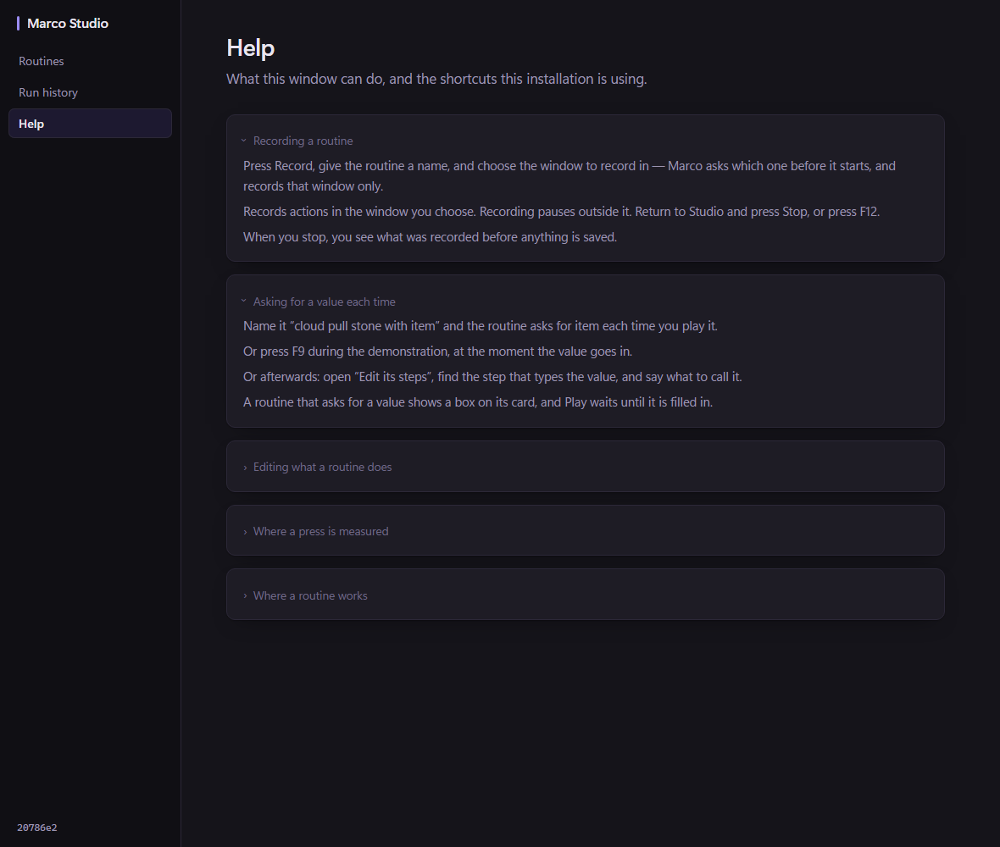
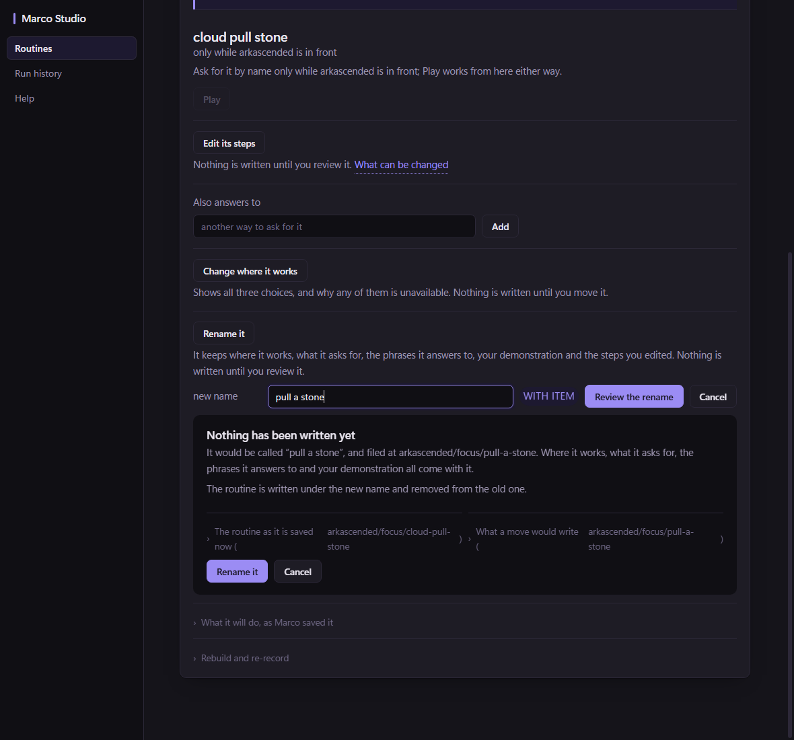
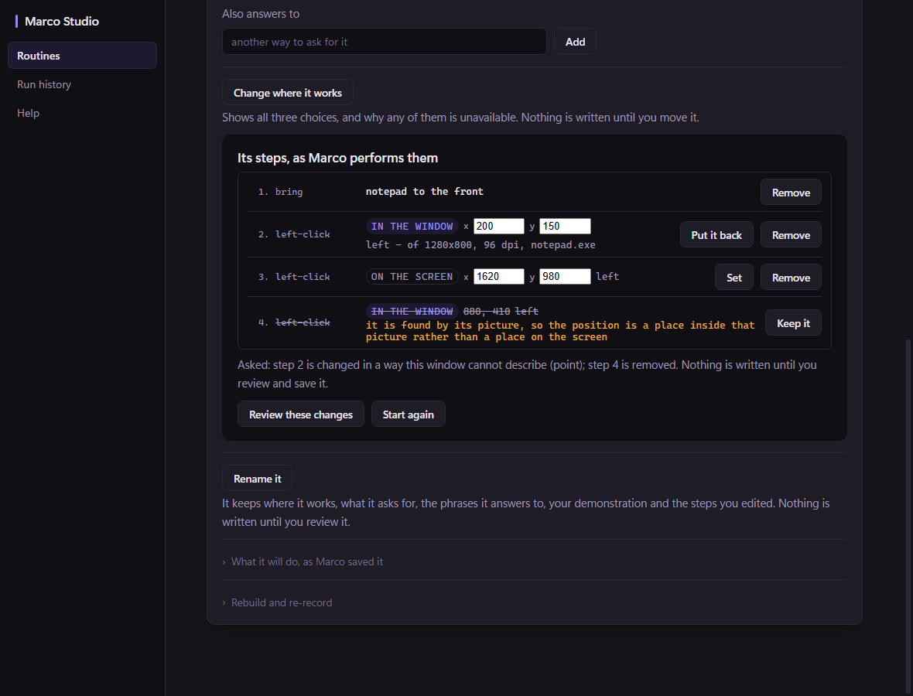

# The alpha UI slice: one journey, a compact editor, rename, and a point that can be moved

Traced at `20786e2`, proposed with the two rendered layouts below, and approved by the Architect
with four decisions and five amendments. **Four slices, in this order.** Each is separately
reviewable.

> The UI still feels clunky. The idea is to remove some of the text by adding a help section,
> acts and scenes get hidden since we don't support them right now, and the edit screen gets a
> facelift + usabilty
>
> — the owner

## The layouts


Three rail entries. Rename inline on the card, with the clause that declares an argument shown
beside the box and **not editable**. The second card is the case rename refuses. Help is one
section; every sentence in it that names a shortcut comes from the backend.


Four columns — number · action · value · controls. The basis is a badge rather than a sentence.
No paragraph sits on a monospace row; the refusals and the pair warning do, because they are what
somebody is about to act on.

Both are rendered against Studio's own stylesheet in headless Edge, at 1180px. They are the
PROPOSALS, kept as the record of what was approved and amended.

## As built

All four slices are landed. These are the real page, rendered in headless Edge over a stubbed
backend — the same harness the rendered tests use, so what they show is the page's own markup and
stylesheet rather than a mock of it.







The editor shot has one of each row: a press measured inside a window with its offset editable
and its window terms beside it, a press measured on the desktop, and a press found by its picture
which says on its row that it cannot be moved — struck out, because that row is also asked to be
removed, with the reason outside the strike.

## What was traced first

### Coordinates

Three step kinds carry points — `StepClick`, `StepDrag`, `StepMove`. A press measured inside a
window carries ADR-250's five terms, and **their presence is the opt-in** for the guarded
contract. From the owner's own routine:

```
the p1 is a Point with X 342, Y 294, RelX 342, RelY 294, RelTo "window",
                       WinW 1920, WinH 1080, Dpi 96, Process "arkascended.exe".
```

The fact that makes a coordinate editable at all: the absolute point and the relative offset were
measured **at the same instant**, so the window origin is recoverable as `(X-RelX, Y-RelY)`.
Editing the offset can therefore move the screen point with it, from the same measurement —
nothing is invented and no new reading is taken. Without that, editing either number makes the
other one a lie.

A click that carries `Template`, `Color`, `AnchorText` or `AnchorVision` must refuse: its
`AnchorClickX/Y` is a position INSIDE a picture, so moving the point re-aims the picture at
somewhere else.

### Rename

Nothing renames today. `Deps.Rescope` (`internal/orchestrator/rescope.go`) is already the whole
move engine: deterministic two-route lock ordering, revalidation of the source, recording, aliases
and steps digests **at both ends**, version-bound collision consent, exclusive asset writes, the
destination read back **before** the original is removed, and it carries the recording, the steps
account rebound to the new source digest, and the aliases rebound to the new route. Rename is that
engine with a destination that differs by **slug** rather than by application or scope.

Two things bite:

1. **The name is where the arguments are declared** (`routes.SplitArgs` on
   `cloud pull stone with item`), so a free-text rename box is a way to silently drop one.
2. **A declared secret is route-qualified** — `codegen.typeSentence` emits
   `do OS's Secret with "<route>:password"`, and its own comment says what disagreeing about that
   costs: *looking up a secret nobody stored*. Re-rendering under a new name would move the
   credential name, so that case is REFUSED rather than performed. Nothing reads or migrates a
   credential.

### The shell

`paintViews` walked a hardcoded `['routines','acts','scenes','history']` and touched
`$('rail-' + v)`. Remove a button and the page throws mid-paint and stops rendering **entirely**
— so the elements stay in the document and the LIST comes from the backend.

### Help

None existed. 82 `muted` blocks in the page, 22 of them in the Routines view. But
`everywhereSentence` and `argSentence` name **F12 and F9 read from the environment**, so those
sentences cannot become static help text without reintroducing the exact two-readings defect that
already shipped on the record card once.

## The Architect's decisions

| | |
| --- | --- |
| **Rename** | Arguments as a non-editable chip; the box edits only the name. Preserve scope, aliases, demonstration and stored steps. A reviewed move. Collisions refused — **no overwrite option**. |
| **Coordinates** | Edit window-relative X/Y for measured clicks, deriving the screen point from the recorded origin. For unmeasured points, edit screen X/Y. **One** editable pair, clearly labelled; derived values may be read-only. |
| **Drags** | Out of this slice. Anchored clicks stay non-editable with a short reason. |
| **Flags** | Environment flags, read **once at Studio startup**, default off for Acts and Scenes. No settings UI or runtime toggle. Hidden views must not break navigation or keep unnecessary polling active. |

And five amendments to the layouts, applied to the renders above:

1. No explanatory prose in the editor's monospace rows — the coordinate paragraph moves into
   Help. The basis badge, the values and a short refusal stay on the row. X/Y fields get explicit
   labels and the remove buttons get accessible names.
2. Fix the struck-through pair warning: strike only the removed action and value; the explanation
   stays readable. (A real defect in today's page, not only in the mock — `.pair` is a child of
   `.what`, and `text-decoration` reaches every descendant and cannot be taken off one.)
3. Correct Help's recording claim: it records **the window explicitly chosen beforehand**, not
   "the window you go to". Use the configured shortcut values.
4. Rename preserves behaviour, including route-qualified secret lookups; where preservation is
   unsupported, refuse that case explicitly.
5. A changed point keeps its button, its modifiers and every guard term. Incomplete measurements
   and invalid relative positions are refused rather than completed — **don't manufacture a
   guarded point.**

Carried forward unchanged: the displayed-list basis, the review token and the stale-source
protections, now also for coordinate edits; and the move engine's read-back and
original-retention guarantees for rename.

## The four slices

| | What it touches | What it refuses |
| --- | --- | --- |
| **1 — Flags and Help** | `Acts.Features`, `Acts.Help`, the rail, `paintViews`, `show`, the startup polls | a view that is not offered |
| **2 — The compact editor** | `.sr` rows, `drawStepRows`, the prose that moves to Help | nothing new |
| **3 — Rename** | `PrepareRename`/`Rename` over the Rescope engine | a collision, an unchanged name, a route-qualified secret |
| **4 — A point can be moved** | one new `StepEdit` op beside `typedRun` and `suppliedName` | an anchored click, a drag, an incomplete measurement, an off-window offset |

Slices 1 and 2 touch no saved routine. 3 and 4 do.

## And what the owner said when they looked at it

Two messages, the morning after the four slices landed:

> add the ability to rename routines. The play button needs to be bigger too, there's still too
> much text, like we don't need window size and scale checked before each press, that type of
> stuff belongs in the help section

> there's aliasing, but no straight rename

**Slice 3 was already in the binary they were looking at.** `studio.exe` was written at 08:56:06
and the window opened at 08:56:10, and the exe contains `routineRenameBox`. What they met before
it was the box that adds another phrase a routine answers to — four deed rows above it, and a
convincing enough answer to the question *where do I change what this is called* to end the
search.

So the finding is not about the rename. It is about this window's third hidden capability, and
the first one that was **visible the whole time**: Simplify was collapsed in a `<details>` and
the learn offer was unreachable, which are both the same mistake. This one was expanded, on the
page, two scrolls down. What decides whether somebody finds a control is not whether it is
visible but what they meet before it.

The rest is the same complaint as slice 2's, one surface further in: a true sentence in the wrong
place. The guarded contract's *Checks the program, window size and scale before each press* sat a
few lines above the press-in row that says the same thing about the window a run will raise, and
the step editor printed the window's size and scale beside every movable press. Both moved into
Help; the card is silent for the ordinary case and keeps the two contracts that are a warning.

Taken up in [[ADR-289-the-panel-says-less-and-play-is-bigger]].

And then the Architect replaced the panel itself:

> Replace the separate selected-routine card with an inline accordion. [...] Open one routine at a
> time. [...] Preserve unsaved inputs when clicking Rename, Play or other controls — those clicks
> must not toggle the row. If switching routines would discard pending edits, make that explicit.

> keep **Play on the collapsed row** [...] Keep a single primary Play button per routine — don't
> duplicate it inside the expanded section.

Taken up in [[ADR-290-a-routine-opens-where-it-is]], with the six rendered states it asked for in
`docs/images/studio-ui/8-rows-*.png`.

And then read them, and found the step editor's press row:

> One visible issue remains in **8-rows-editor-normal.png**: the coordinate row has no action
> verb, and X/Y split across lines. Keep **Click · window-relative X/Y · controls** readable as
> one row at normal width; stack the fields deliberately at narrow widths.

Taken up in [[ADR-291-the-press-row-says-what-it-does]], which also records that the missing verb
in that frame was the render stub's and not the product's — the stub wrote a sentence `oneStep`
never writes. All six states are re-rendered from a corrected stub.

## See also

- [[ADR-283-the-alpha-offers-one-journey-and-the-window-explains-itself]] — slice 1
- [[ADR-284-the-step-editor-is-a-list-of-rows]] — slice 2
- [[ADR-285-a-routine-can-be-called-something-else]] — slice 3
- [[ADR-286-a-press-can-be-moved]] — slice 4
- [[ADR-287-a-re-render-keeps-the-credential-it-was-reading]] — the correction slice 3 found
- [[ADR-288-the-rail-keeps-its-build-stamp-when-scenes-is-withheld]] — the polling split slice 1 deferred
- [[ADR-289-the-panel-says-less-and-play-is-bigger]] — what the owner said when they looked at it
- [[ADR-290-a-routine-opens-where-it-is]] — and the accordion that replaced the panel
- [[ADR-291-the-press-row-says-what-it-does]] — and the one row they found in the renders
- [[Studio-journey-discoverability-2026-10-31]]
- [[Studio-UI-audit-2026-10-29]]
- [[ADR-282-a-run-of-steps-can-be-said-to-be-typed-text]]
