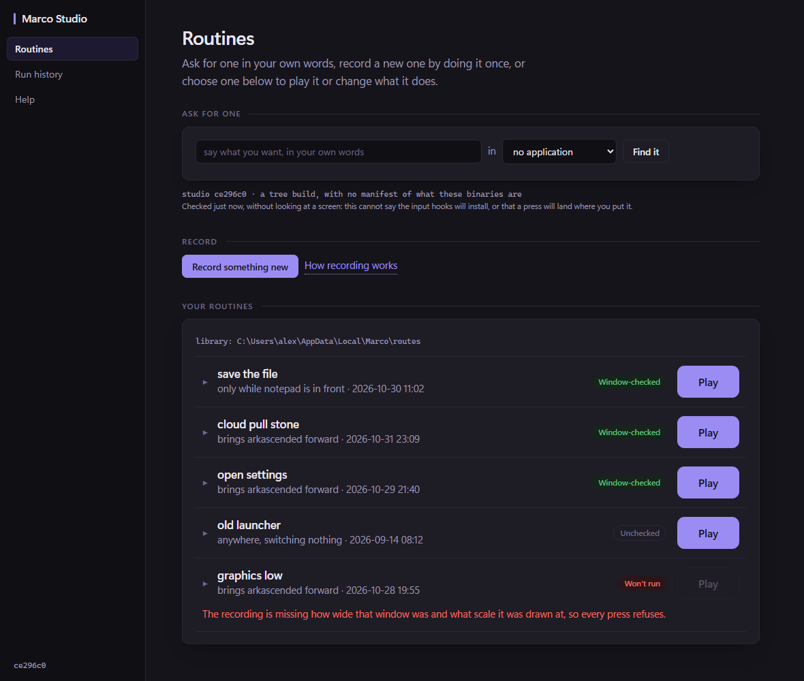
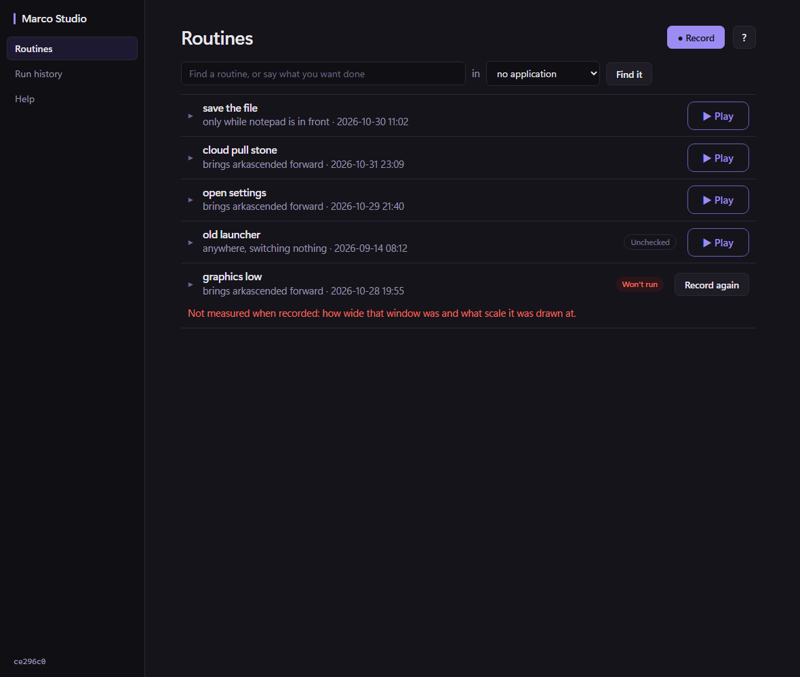
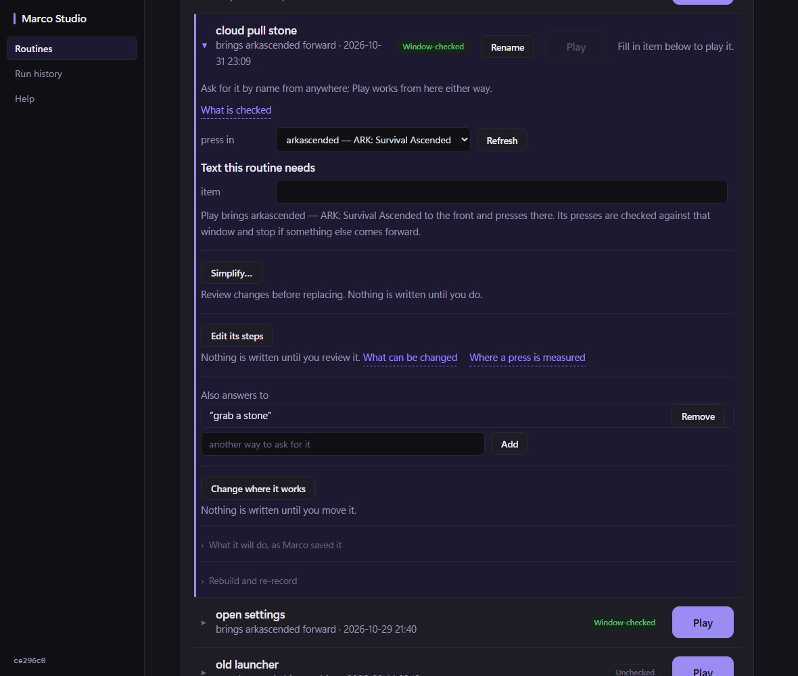
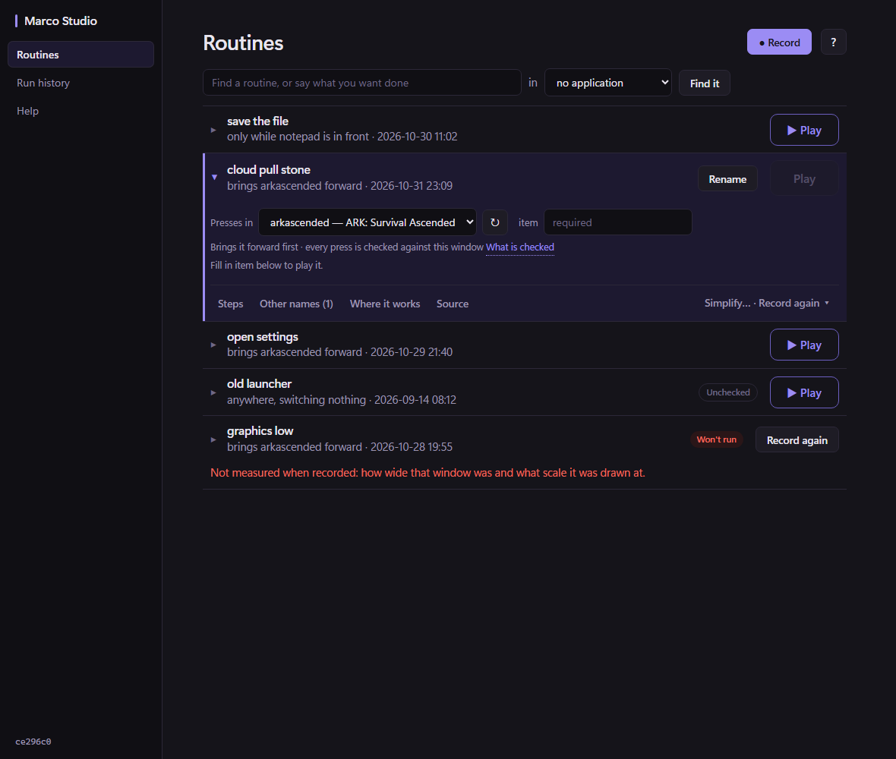
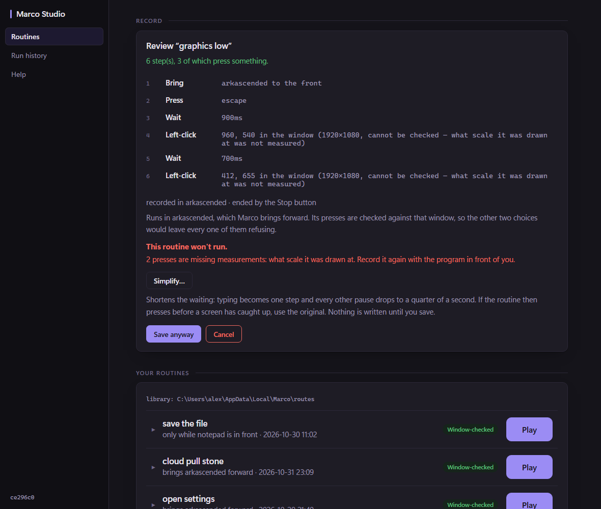
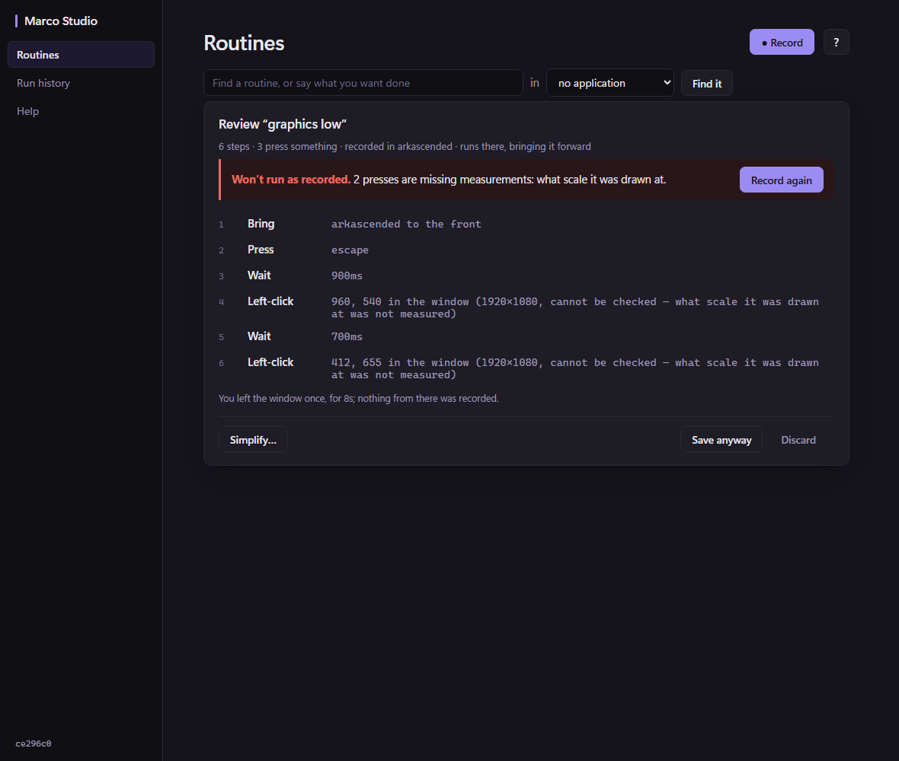

# Studio coherence audit — less explanation needed to use it

An audit and a proposal. **Nothing in the product was changed.** It was audited at `ce296c0` on
`feat/demonstrated-acts`, with a clean tree. That branch and HEAD were checked, not assumed.

This follows [[Studio-UI-audit-2026-10-29]], [[Studio-journey-discoverability-2026-10-31]] and
[[Studio-alpha-UI-slice-2026-10-31]]. It builds on the rulings those produced and does not reopen
them:

- the routine row that opens where it is ([[ADR-290-a-routine-opens-where-it-is]]);
- Play on the collapsed row, and a bigger Play ([[ADR-289-the-panel-says-less-and-play-is-bigger]]);
- Help composed by the backend ([[ADR-283-the-alpha-offers-one-journey-and-the-window-explains-itself]]);
- the press row ([[ADR-291-the-press-row-says-what-it-does]]).

## Where each claim comes from

| Mark | Meaning |
| --- | --- |
| **[S]** | **Source inspection** of the page or the Go backend, with file and line. |
| **[R]** | **Headless render** of the production page in Edge, against fixtures that use the backend's own wording. Captured with page errors recorded and visible text measured. |
| **[O]** | **Actual observation.** None in this audit. Studio was not launched, closed or rebuilt. No input was injected and the owner's library was not read. Where the owner's own words are quoted, they come from the ADRs that recorded them. |

### How the renders were made

The production `frontend/index.html` is loaded unmodified. A stub of `window.go` is injected in
front of it, and it answers every binding the page calls.

**Every human-readable string in the fixtures is quoted from the Go backend**, for example
`recording.go`, `routines.go`, `target.go`, `help.go`, `playvalues.go` and
`internal/orchestrator/*`. Field names and value shapes come from the structs' JSON tags.

Three existing page-test stubs turned out not to be safe wording sources, so none was copied:

- `rowpage_test.go` sends scope values production never sends (`app-focus`, `app-context`). It
  also uses a different `saved_at` format and invented step-row fields.
- `renamepage_test.go` uses the same invented scope values.
- `renamepage_test.go` answers a rename with `Renamed it.`, where production says
  `Moved "…" to …`.

Two of my own fixture mistakes were caught by looking at the renders and corrected before any
measurement:

- **The idle record card was missing its three disclosure sentences.** The first draft of
  `04-record-setup` undercounted by 73 words.
- **The rename collision was missing its destination.** Production does fill `to` on a collision
  (`rename.go:75-84`).

**No render threw a page error.** Each render records `window.onerror`, unhandled rejections and
`console.error`, and all 34 came back empty.

The renders were taken at **1180×1000** (normal) and **640×1100** (narrow), dark theme. Narrow is
below the page's own 760px and 960px breakpoints.

The harness, fixtures, state scripts and proposal overlay are kept beside the images in
`docs/images/studio-ui/9-harness/` so they can be rerun. The Go files carry a `.txt` suffix so
`go build ./...` does not compile them.

---

## 1. Assessment

### What works

- **The journey is complete and every step is reachable from one screen.** Record, Stop, review,
  Simplify, Save, open, Play, Rename, edit steps, other names and scope are all there. [R]
- **The accordion is right.** A routine opens where it is. Play stays on the row, and only the
  chevron toggles, so nothing typed into the panel is lost. [S][R]
- **Refusals are specific and honest.** For example: *2 presses are missing measurements: what
  scale it was drawn at.* They should be kept word for word wherever they are actionable. [R]
- **Recording and paused states are visually distinct.** There is a live red band with a pulse,
  and a held amber band. [R]
- **The step editor's four-column row works** at normal width and stacks deliberately when
  narrow. [R]
- **No horizontal scroll and no unnamed controls in any state.** This was checked at both widths
  across all 13 states. [R]
- **The type system is sound.** One sans family, mono kept for values, two radii, one control
  height. [S]

### What does not work

The window still explains itself in prose at the place where a person is trying to act. The cause
is structural, not wordiness sentence by sentence:

1. **Every control carries its own safety sentence.** Thirteen user-visible occurrences, in ten wordings, of *nothing is
   written until…* are in the page. Three review panels are headed **"Nothing has been written
   yet"**, the same heading three times. The page has a strong convention, that every change is
   reviewed before it is written, and it re-proves that convention beside each button instead of
   letting the review step be the proof. [S]
2. **Machine facts sit on the work surface.**
   - The build id appears twice: in the rail, and as `studio ce296c0 · a tree build…`.
   - A readiness caveat sits above Record: *"Checked just now, without looking at a screen: this
     cannot say the input hooks will install…"*.
   - The library path is printed in mono above the list.
   - Route ids such as `arkascended/focus/open-settings` appear in refusals and pane captions.

   None of these help anyone decide what to do next. [R]
3. **The backend writes full explanatory paragraphs, and the page prints them verbatim.**
   - `handoffSays` (`target.go:185-193`) is 27 words under every open routine.
   - `brings` (`recording.go:864-880`) is 26 words on every review.
   - The Simplify explanation (`index.html:3039`) is 41 words.

   Each is true. Together they are a rule written as a sentence where a word and a Help link would
   do. [S]
4. **Maintenance is permanently visible.** An open routine shows five ruled "deed" rows and two
   disclosures: Simplify, Edit its steps, Also answers to, Change where it works, source, and
   Rebuild and re-record. Each has a caption. The routine's own run controls are the top quarter of
   a 760px-tall panel. [R]
5. **Primary emphasis is spent five times over.** The CSS states *"One filled button per screen"*
   (`index.html:389`). The library shows **six** filled buttons: Record plus five Plays. The rename
   collision state shows **eight**. [R]

**Measured.** An open routine with one required value is **280 visible words and 23 buttons**. The
step editor is **406 words, 39 buttons and 2,397px** of scroll. [R]

---

## 2. Prioritized findings

Severity reflects how much a person is slowed down or misled. **V** is visual, **C** copy, **I**
interaction, **B** backend.

| # | Finding | Evidence | User impact | Location | Proposed correction |
|---|---|---|---|---|---|
| 1 | **The routine list is the third section on its own screen.** A lead paragraph, "Ask for one", a build line, a readiness caveat, "Record" and a library path come first. The first routine starts **549px** down. | [R] `9-before-02-library-normal.png` | The thing people come to use, a routine, is below the fold at ordinary heights. The screen reads as a dashboard of sections. | `index.html:740-817, 1213-1218` | One header row: **Routines** with Record and Help on the right. Below it, one find/ask field, then the list. Build, installation, limits and path move to Help. **V I** |
| 2 | **Six filled primary buttons in the idle library**, against the page's own one-primary rule. | [R] counts in `02-library` / `12-rename` | Nothing stands out, so Play everywhere reads as equally urgent and Record loses its weight. | `index.html:462, 3500-3512` | Collapsed-row Play becomes outlined at the same size (ADR-289's size is kept). The open row's Play is the only filled one. Record is filled only when nothing is open. **V** |
| 3 | **An open routine is a stack of five maintenance rows with captions.** Edit its steps, other names and scope open their editors **below** all the other rows, away from the button that opened them. | [R] `9-before-03`, `9-before-11`. [S] `routineSteps` (1558) and `routineMove` (1649) sit after `routineWhereRow` (1533). | Long scrolls. The same "visible but unfindable" failure ADR-289 recorded for Rename, now one level in: the editor appears a screen away from its button. | `index.html:1270-1800` | Replace the deed rows with a one-line tab bar: **Steps · Other names (n) · Where it works · Source · More ▾** (Simplify…, Record again, Review today's rules). The chosen tab's panel opens directly under the bar. **I** |
| 4 | **A recording that won't run offers "Save anyway" as the filled primary**, and has no way to record again from the review. | [R] `9-before-08-review-refusal-normal.png`. [S] `index.html:3190-3191` | The emphasized next step is to save a broken routine. The real remedy is in the refusal text but has no button. | `index.html:1160, 3176-3191` | The refusal becomes a banner at the top of the review with **Record again** as primary, reusing the same name and window. **Save anyway** becomes secondary. **I** |
| 5 | **The backend's `away` sentence is never shown.** *"You left the window once, for 8s in all…"* Its own comment says it *"is on the review card because the draft is SHORTER than the demonstration they gave and nothing else here explains why."* | [S] `recording.go:208-214, 802`. `index.html` never reads `r.away`. | A person who stepped away sees a shorter routine than they demonstrated, with no explanation. This is complete backend work that was never shown. | `index.html:2893-3197` (`pollCapture`) | Show it as one muted line under the steps, beside the exit-key note. **I** (front-end only) |
| 6 | **Step editor: a coordinate or wait typed without pressing that row's Set is silently dropped** when *Review these changes* is pressed. | [S] `askStepChange` runs only from Set (`index.html:4041` for a wait, `4099-4105` for a point). `reviewStepEdit` sends `stepChanges` only (4232-4253). | Data loss that looks like success: the review shows *nothing was asked* or other changes, and the typed number is gone. | `index.html:3891-4253` | A field whose value differs from the original **is** the change. Drop per-row **Set**. The row shows a "changed" mark and a reset (↺). Review collects every changed field. **I** |
| 7 | **Number fields are unstyled white boxes** in both themes. There is no base rule for `input[type=number]`; only widths are set. | [R] `9-before-11-step-editor-normal.png`. [S] `index.html:316, 359` | The step editor, the most precise surface, looks unfinished and inconsistent with every other field. | `index.html:482-495` | Give `input[type=number]` the same token style as `input[type=text]`. **V** |
| 8 | **Rename collision appears about 650px below the field that caused it.** It sits in a card headed *"Nothing has been written yet"*. It first describes the successful outcome (*"It would be called… filed at… all come with it"*), then the refusal, then *"Nothing has been written: the reason is above."* It names a route id, not the routine. | [R] `9-before-12-rename-collision-normal.png`. [S] `index.html:4527-4550`. Copy from `internal/orchestrator/rename.go:91`. | Three statements of "nothing happened", one of them contradictory, and none at the place the person is looking. | as listed | Validate inline, under the name field: **"open settings" is already a routine in arkascended. Choose another name.** Open the review pane only for a valid rename. **I C B** (the backend copy should name the routine, not the route id) |
| 9 | **The confirmation's "what it will type" list is laid out wrong.** `ol.steps li` is a three-column grid and the confirmation writes plain text into it, so `item — "granite"` breaks across two lines in a 96px column. | [R] `9-before-10-confirm-normal.png`. [S] `index.html:279, 5170` | The one place a person verifies a value before a run looks broken. | `index.html:1398, 5147-5178` | Give the confirmation its own simple list, or span the line `grid-column:1/-1`. **V** |
| 10 | **On the open row, "Fill in item below to play it." takes width from the name**, so the date wraps mid-value (`2026-10-` / `31 23:09`). It also says *below* for a field that is above it at narrow width. | [R] `9-before-12-rename-collision-normal.png`, `9-before-09-arguments-narrow.png`. [S] `#routineWants` is not `.rowsays` (`index.html:3511`). | The routine's own name and date become hard to read in exactly the state where it is being used. | `index.html:241, 3511, 5248` | Give it `.rowsays` (full-width line), or move it into the run strip. Copy: **Fill in item to play.** **V C** |
| 11 | **Text needed to read the page is below WCAG AA contrast.** `--faint` (#6f6885) on the card surface is **3.20:1** in dark and **3.62:1** in light. It is used for the section labels (11.5px caps), every disclosure summary (*What it will do…*, *Rebuild and re-record*, all Help titles), step numbers and the *Unchecked* pill. | [S] tokens `index.html:45, 92`; contrast computed. [R] Help render. | Help's section titles, the main way into Help, are the faintest text on the page. | `index.html:174, 268-272, 512` | Raise `--faint` to at least 4.5:1, or use `--dim` (5.9:1) for any text that carries meaning. **V** |
| 12 | **"Window-checked" is shown on every ordinary row.** ADR-289 ruled that the guarded contract *"now says NOTHING"* on the card. The pill still says it, five times down a list. | [R] `02-library`. [S] `index.html:3486` | Badge noise that trains people to ignore badges, including *Won't run*. | `index.html:3485-3487` | Silent for guarded routines. Badges only for exceptions: **Unchecked** and **Won't run**. **V** |
| 13 | **The recording band says "what you are *teaching*".** CLAUDE.md reserves TEACH for Marco guiding a person, and the overlay says *learn*. | [S] `index.html:975` | A word the product has deliberately reserved for something else. | `index.html:974-975` | *"Come back here and press Stop when you're done. Switching back is left out of the recording."* **C** |
| 14 | **While recording, the band repeats an instruction that can no longer be followed**: *"Add 'with item' to the name above…"*. The name field is gone. | [R] `9-before-05-recording-normal.png`. [S] `capArgBand` mirrors `arg_says` (`index.html:2941`). | Noise in the one state where a glance has to be enough. | `index.html:973` | While recording, show only the key: **F9 marks a value to ask for.** Naming advice belongs on the setup card. **C** (front-end can choose which half to show) |
| 15 | **Play stays enabled on every row while a recording is in progress.** The backend then refuses. | [R] `05`/`06`. [S] `index.html:5227` checks `runActive` only. | A press that looks available and is not. | `index.html:5221-5230` | Disable Play while `captureActive`, with the row line *Recording — finish it first*. **I** |
| 16 | **The ask box's provenance line is diagnostics on the work surface.** For example: *read against notepad… · 3 routine(s) offered · exact · no resolver is configured… set $MARCO_RESOLVER…*, in mono. | [S] `index.html:787, 3397` | Environment-variable advice on the main screen of a consumer alpha. | `index.html:3397` | Keep the reply. Move provenance behind a *Details* disclosure or into Help, which can show the resolver status. **C I** |
| 17 | **With no known applications, the ask box's "in" dropdown has no options at all.** It never gets its *no application* entry, because an empty answer matches the empty initial signature. | [R] `9-before-01-empty-normal.png`. [S] `index.html:3337` | An empty, unlabeled select on the empty-library screen, the first thing a new person sees. | `index.html:3333-3360` | Initialise `askTargets` to a sentinel, or always build the *no application* option. In the empty library, hide the ask row entirely until there is something to find. **V I** |
| 18 | **Terminology drifts between surfaces.** <ul><li>The overlay says **play**, **learn** and **control centre**: *"record a new play"*, *"no plays yet — `m learn <name>`"*. Studio says **routine** and **Record**.</li><li>Studio alone uses Play / Run it / Run history for one thing.</li><li>It uses Cancel, Discard-as-red-Cancel, Start again and Put it back.</li><li>Field labels are lowercase fragments (`record`, `call it`, `press in`, `it works`) next to Title-case headings.</li></ul> | [S] `plugins/overlay/commands.go:144-149, 316`; `index.html` | A person moving between the HUD and Studio meets two names for one thing. Inside Studio, one verb has several labels and one label (red Cancel) has two meanings. | — | One glossary (§4.6). **C** |
| 19 | **README still says recording watches everything.** *"Recording only a chosen window is not something Marco can do yet, and the window says so before you press Record."* | [S] `README.md:19-24`, contradicted by [[ADR-268-record-only-the-chosen-window]] and by Studio's own Help | The user-facing description of Studio contradicts Studio. | `README.md` | Copy fix, in the same pass as #13. **C** |
| 20 | **The step editor's point "Set" button has a wrong accessible name**: *"Move step 7 where it was"*. The wait row has a second **Set** with a different meaning. | [S] `index.html:4097-4098, 4039` | A screen reader announces the opposite of what the button does. Two identical labels in one table do different things. | as listed | Removed with #6, since there is no Set. If kept: name it *"Move step 7 to these coordinates"*. **I** |
| 21 | **Review cards stack status lines above the thing being approved.** In an ordinary review, *said*, *exit*, then steps, then *where*, *brings* and a 41-word Simplify paragraph, then Save. | [R] `9-before-07-review-normal.png` | Save is about 600px into the card. The steps, which are what is being approved, are framed by prose on both sides. | `index.html:987-1185` | One meta line (*7 steps · 2 press something · recorded in notepad*). Then the steps. Then a footer: **Simplify…** on the left, **Save** and **Discard** on the right. The Simplify explanation goes in its tooltip and Help. **V C** |
| 22 | **During review the library stays below with five live Plays.** | [R] `07`/`08` | Competing actions while a person is deciding Save or Discard. | `index.html:1215` | Collapse the library while a recording is being recorded or reviewed. **I** |

Smaller notes, all [R]:

- At narrow width the rail brand wraps to two lines.
- `refresh` and `Refresh` are both used.
- The Help view's cards are a `details` border inside a card border, which reads as a double rule.

---

## 3. Visible-text inventory

### By state

Words are visible words, counted by walking every rendered text node with layout and skipping
closed disclosures. *Prose* is sentences and status lines, without button, label and heading text.
Normal width.

| State | Words | Prose | Buttons (filled) | Scroll height | Image |
|---|---:|---:|---:|---:|---|
| Empty library | 103 | 67 | 3 (1) | 908 | `9-before-01-empty-*` |
| Library, five routines | 162 | 81 | 13 (6) | 1038 | `9-before-02-library-*` |
| Routine open | 267 | 150 | 22 (6) | 1693 | `9-before-03-expanded-*` |
| Record setup | 251 | 164 | 15 (6) | 1396 | `9-before-04-record-setup-*` |
| Recording | 182 | 117 | 13 (6) | 1180 | `9-before-05-recording-*` |
| Paused | 190 | 125 | 13 (6) | 1207 | `9-before-06-paused-*` |
| Review, ordinary | 295 | 195 | 14 (6) | 1640 | `9-before-07-review-*` |
| Review, refusal | 316 | 191 | 14 (6) | 1635 | `9-before-08-review-refusal-*` |
| Arguments required | 280 | 157 | 23 (6) | 1827 | `9-before-09-arguments-*` |
| Run confirmation | 282 | 152 | 25 (7) | 1996 | `9-before-10-confirm-*` |
| Step editor with coordinates | 406 | 174 | 39 (6) | 2397 | `9-before-11-step-editor-*` |
| Rename collision | 368 | 217 | 27 (8) | 2222 | `9-before-12-rename-collision-*` |
| Help, one section open | 108 | 72 | 0 | 908 | `9-before-13-help-*` |

### Each visible sentence, classified

**Necessary now** means the person needs it to act in this state. **Duplicate** means it is said
elsewhere on screen or is implied by the control. **Help** means it is true and useful, but only
on request.

| Sentence (state) | Words | Class | Note |
|---|---:|---|---|
| *Ask for one in your own words, record a new one by doing it once, or choose one below…* (all) | 25 | Duplicate | It describes the three controls directly beneath it. |
| `studio ce296c0 · a tree build, with no manifest…` (idle) | 12 | Help | The rail already shows the build. Move to Help → About. |
| *Checked just now, without looking at a screen: this cannot say the input hooks will install…* (idle) | 25 | Help | A readiness caveat. **A readiness *problem* stays on the main screen.** |
| `library: C:\Users\…\routes` (all) | 3 | Help | Keep `libElsewhere`, which is actionable, on screen. |
| *Window-checked* ×n (library) | 1×n | Duplicate | The ordinary case, per ADR-289. |
| Unrunnable routine's refusal line (library) | 20 | **Necessary** | Pair it with **Record again**. |
| *Ask for it by name only while notepad is in front; Play works from here either way.* (open) | 16 | Duplicate / Help | The row's meta line already says *only while notepad is in front*. The rest belongs to the *Where it works* tab. |
| *Play brings notepad — Untitled - Notepad to the front and presses there. Its presses are checked against that window and stop if something else comes forward.* (open) | 27 | Half necessary | The window is shown in the select. Keep **"brings it forward first · checked against this window"** plus a link. |
| *Review changes before replacing. Nothing is written until you do.* / *Nothing is written until you review it.* / *…until you move it.* (open) | 23 | Duplicate | The review step is the guarantee. State the convention once in Help. |
| *Also answers to* (open) | 3 | Necessary | It becomes the tab label *Other names*. |
| *Where you press and how long you pause, and nothing about how the screen looked. It does not take a picture of anything.* (record setup) | 23 | Help | A good privacy statement. One short line can stay: *Records clicks, keys and timing, never screenshots.* |
| *Records actions in the window you choose. Recording pauses outside it. Return to Studio and press Stop, or press F12.* (record setup, banner) | 20 | **Necessary** | A banner for something that is not a warning. Make it plain text by the Record button. |
| *Open it first if it is not in the list.* (record setup) | 9 | Necessary | It can live in the select's empty state. |
| *Press F9 during the demonstration… Add "with item" to the name above…* (setup, then recording) | 28 | Necessary at setup, wrong while recording | See #14. |
| *Switch back to this window whenever you are done — … what you are teaching.* (recording) | 19 | Necessary, with the wrong word | See #13. |
| *Paused: you have left notepad — Untitled - Notepad. Nothing you do elsewhere is being recorded. (12s)* (paused) | 17 | **Necessary** | Keep. |
| *7 step(s), 2 of which press something.* + *recorded in notepad · ended by the stop key* (review) | 15 | Necessary, split in two | Merge into one meta line. |
| *The alt+tab you used to leave the window and come back here are how the recording was ended, not part of it, so they were left out.* (review) | 27 | Necessary, but long | *The alt+tab you used to come back was left out.* |
| *Runs in notepad, which Marco brings forward. Its presses are checked against that window, so the other two choices would leave every one of them refusing.* (review) | 26 | Half necessary | The second sentence explains why the scope choice is hidden. That is Help (`scope`). |
| *Shortens the waiting: typing becomes one step and every other pause drops to a quarter of a second. If the routine then presses before a screen has caught up, use the original. Nothing is written until you save.* (review) | 41 | Help | Tooltip plus Help. *Use the original* is offered by its own button after simplifying. |
| *This routine won't run.* + missing-measurement sentence (refusal) | 20 | **Necessary** | Keep, with the remedy as a button. |
| *Fill in item below to play it.* (arguments) | 7 | Necessary | Fix *below* (#10). |
| *Run "cloud pull stone"?* + *item — "granite"* (confirm) | 6 | **Necessary** | A meaningful confirmation. Keep. |
| *removing this removes step 5 as well, because they are the two halves of holding "ctrl"* (editor) | 17 | **Necessary** | A destructive consequence. Keep it on the row. |
| *it is found by its picture, so the position is a place inside that picture rather than a place on the screen* (editor) | 21 | Necessary, but long | *Found by its picture — can't be moved* plus a link to Help `measured`. |
| *Asked: step 2 is removed. Nothing is written until you review and save it.* (editor) | 14 | Half duplicate | Keep the change list as *1 change*. Drop the guarantee. |
| *Nothing has been written yet* ×3 headings | 5×3 | Duplicate | Title the panel by its content: *Review rename*, *Review step changes*, *Review rebuild*. |
| *It would be called … and filed at … all come with it.* (collision) | 31 | Wrong in this state | It describes a success that is refused. Show it only when movable. |
| Collision refusal | 19 | **Necessary** | Move it to the field and name the routine (#8). |
| *Nothing has been written: the reason is above.* | 7 | Duplicate | Drop. |

### Totals for the classified sentences

| Class | Words | Share |
|---|---:|---:|
| **Necessary now** | ≈ 200 | ≈ 40% |
| **Duplicate** | ≈ 160 | ≈ 32% |
| **Help candidates** | ≈ 140 | ≈ 28% |

**What must not be cut** in any later copy pass, about a third of the necessary text:

- every refusal;
- the unsaved-change warning in `routineLeaving`;
- the pair-removal consequence;
- the paused line;
- the run confirmation;
- the *recorded somewhere else* warning (`again_elsewhere`), which is the one case where Save
  makes a second routine.

### What Help is missing

Help covers recording, arguments, editing, measurement, checks and scope. It has **no section**
for:

- **Simplify**: what it changes and when to use the original.
- **Other names**: aliases.
- **Rename**: what is kept, and why a credential-reading routine refuses.
- **Play and its confirmation.**
- **The review convention**: *nothing is written until you review it*.
- **About this installation**: build, library, readiness limits.

All six are what the inventory above sends to Help. Adding them is a `help.go` copy change.

---

## 4. Principles for Marco Studio

Five principles, drawn from what this window keeps getting wrong. Every proposal below follows from
one of them.

1. **The routine is the noun, and the list is home.** The library is the first thing on the
   Routines screen. Everything else is either about one routine, so it opens in that routine's
   row, or about making one, so it is a single Record button.
2. **One emphasized action per state.**

   | State | The one emphasized action |
   | --- | --- |
   | Idle | Record |
   | Routine open | Play |
   | Review | Save, or **Record again** when it won't run |
   | Recording | Stop |

   Everything else is secondary or quiet. Red is for destruction (Discard, Remove, Stop a run),
   never for a cancel that loses nothing.
3. **Say it once, where it can be acted on.** A consequence is stated where it can happen. A
   convention is shown by the interaction, not narrated beside each control: every change opens a
   review, so no button needs to say *nothing is written*. The ordinary case is silent, which
   extends ADR-289 to badges and captions.
4. **A refusal stands beside the field that caused it, with its fix as a button.**
   - *Won't run* → **Record again**.
   - Name taken → inline under the name.
   - Value missing → the field is focused.

   Refusal text is never shortened into vagueness. It is moved, not cut.
5. **Machine facts belong in Help, not the work surface**: build ids, paths, route ids, resolver
   configuration, readiness limits. The exception is when one of them is the reason something is
   refused, and then it is translated into the routine's name.
6. **One word per thing, across Studio, the overlay and the README.**

   | Thing | Recommendation |
   | --- | --- |
   | routine / play | Pick one product noun for a saved, runnable demonstration and use it on all three surfaces. *Routine* is Studio's and the README's. *Play* is also the verb on the button, which argues for *routine* as the noun. **An owner decision; see §8.** |
   | Record / learn | *Record* in Studio is the person's action. The overlay's `learn` command can stay as the command word, with its listing text saying *record a new routine*. LEARN stays the umbrella term, per CLAUDE.md. |
   | Play / Run it / Run history | **Play**, **Play it?** in the confirmation, **History**. |
   | Cancel / Discard / Start again / Put it back | **Discard** for losing a recording, **Cancel** for closing a panel, **Reset** (↺) for a row. |
   | labels | Sentence case: *Window*, *Name*, *Presses in*. |

These do not repeat [[Studio-UI-audit-2026-10-29]]. That audit was about order. These are about
emphasis and where explanation lives.

---

## 5. Comparison with familiar desktop tools

This section is from general familiarity, not an observation made in this session. It compares
interaction conventions, not appearance.

| Convention | Seen in | Why it fits Marco |
|---|---|---|
| **Library-first window with the create action in the header** | Power Automate Desktop's flow list, macOS Shortcuts, Keyboard Maestro | It is the same object model: a list of named automations, each run or edited. It answers *"where do I start?"* without a lead paragraph. |
| **Row actions plus an overflow menu** | Power Automate Desktop (Run / Edit / ⋯), VS Code's explorer, Windows Explorer | Maintenance (Simplify, re-record, rebuild) is used rarely and should cost one click to reach, not a screen of permanent rows. |
| **Tabs or segments inside a detail view**, with the panel under its tab | Shortcuts' editor, Windows Settings pages | It fixes finding #3 structurally. An editor can no longer open below unrelated controls. |
| **Inline validation** | Explorer's rename, VS Code's rename box | The collision is known before the review is opened. Showing it at the field removes a card and three sentences. |
| **"Dirty" field state with a single review or apply** | Settings "Apply", IDE modified markers | It replaces per-row **Set** and removes the silent-drop defect (#6). |
| **A compact recording indicator outside the main window** | Snipping Tool screen recording, PAD's recorder, screen recorders | Studio's recording band is behind the application being demonstrated, the visibility problem [[Studio-journey-discoverability-2026-10-31]] §4 named. Marco already has a HUD (the overlay) that draws `● rec 0:12`. **Not proposed here.** It would need cross-process work and is noted as an option, not a requirement. |

**What not to copy.** Fluent and macOS visual styling, iconography that needs an icon font, and
hover-only actions. Hover-only fails keyboard and touch users, and this page's rule is that a
control is a real, focusable button.

---

## 6. The three highest-impact improvements, before and after

The "after" images are **mockups made by layering CSS and DOM changes on the production page**
(`9-harness/proposal.js`). The page still paints itself from the same fixtures, and the overlay
only moves, hides, restyles or relabels existing elements.

Two exceptions are proposed interactions with no wiring in the mockup:

- the tab bar's buttons;
- **Record again** in the review.

They are not production code and decide nothing. Measured the same way as §3.

### A. The library is the screen (findings 1, 2, 12, 17)

| Before | After |
|---|---|
|  |  |

| Measure | Before | After |
| --- | --- | --- |
| First routine starts at | 549px | 159px |
| Visible words | 162 | 77 |
| Prose words | 81 | 21 |
| Filled buttons | 6 | 1 (Record) |

What changed:

- The lead paragraph, the section labels, the build line, the readiness caveat and the path are
  gone from this screen. They go to Help → About.
- Find and ask are one field.
- Collapsed-row Play is outlined at the ADR-289 size.
- *Window-checked* is silent.
- The unrunnable routine's dark Play becomes **Record again**, and its refusal is shortened to the
  missing measurement. The refusal is not removed.

Narrow: `9-after-A1-library-narrow.png`.

### B. An open routine is a run strip and a tab bar (findings 3, 10, and the inventory)

| Before | After |
|---|---|
|  |  |

| Measure | Before | After |
| --- | --- | --- |
| Whole-screen visible words | 280 | 113 |
| Prose words | 157 | 39 |
| Open panel height | ≈ 760px | ≈ 200px |

What changed:

- **Window, Refresh (↻) and the required value** sit on one line under the name.
- One short line says what Play will do, with the Help link.
- *Fill in item to play* sits in the strip, not beside the name.
- Steps, Other names (with a count), Where it works and Source become tabs. Simplify, Record again
  and the generation review move under **More**.
- All four "nothing is written" captions are gone. Each tab's panel is itself the review.

Narrow: `9-after-A2-open-narrow.png`. Play still wraps under the name below 760px. That is the
page's current, deliberate rule, and a natural next refinement is a compact icon Play at that
width.

### C. Review: the steps are the thing, and a refusal comes with its remedy (findings 4, 5, 21, 22)

| Before | After |
|---|---|
|  |  |

| Measure | Before | After |
| --- | --- | --- |
| Review card words, won't-run review | 163 | 103 |
| Review card words, ordinary review | 140 | 59 |

What changed:

- One meta line replaces *said*, *where* and *brings*.
- The refusal is a banner at the top with **Record again** as the primary, and *Save anyway*
  becomes secondary.
- The **`away` sentence is finally shown**. Its wording is abbreviated in the mockup, and the
  backend's own sentence should be used.
- Simplify sits in the footer with its explanation as a tooltip. Discard is quiet.
- The library is hidden while a recording is under review.

Ordinary review: `9-after-A3b-review-normal.png`. Narrow: `9-after-A3-review-refusal-narrow.png`.

In the mockup, the header's Record button stays filled during review. **In the proposal it is
disabled while recording or reviewing**, which the mockup does not show.

---

## 7. Staged plan

Each stage can be reviewed on its own. Stages 1 and 2 change no behavior. No owner-library change
is needed at any stage.

### Stage 1 — Visual (no behavior, no copy)

1. Style `input[type=number]` from the same tokens as text fields (#7).
2. Bring `--faint` to at least 4.5:1, or move meaning-bearing text to `--dim`, in both themes (#11).
3. Fix the confirmation list layout (#9) and the open-row line wrap (#10).
4. One filled button per state: collapsed-row Play outlined at the same size (#2). Silence
   *Window-checked* (#12).
5. Flatten the library card. Rows sit on the page under a single header row.
6. Help: remove the double rule. Section titles at readable contrast.

### Stage 2 — Copy (page-owned strings only)

1. Remove the duplicate *nothing is written* captions and the triple *Nothing has been written
   yet* heading. Title review panels by their content.
2. *teaching* → *recording* (#13). Show the recording-time F9 line without the naming advice (#14).
3. Sentence-case field labels. One word for each of Play, Discard, Cancel and Reset (§4.6).
4. *Fill in item to play* (#10).
5. The README's stale recording claim (#19).
6. The overlay's listing text, *record a new play*, aligned to whichever noun the owner chooses.

### Stage 3 — Interaction (front-end only, existing bindings)

1. **Header row and merged find/ask field.** Build, path and readiness limits move to a Help
   *About* section. Readiness *problems* stay on the main screen (#1, #16, #17).
2. **Tab bar in the open routine.** Each editor opens under its tab, and More holds Simplify,
   Record again and Review today's rules (#3). This keeps ADR-290's single carried panel; the tabs
   only choose which part of it is shown.
3. **Direct-edit step rows.** A changed field is the change, and Set goes (#6, #20). Review still
   goes through `ReviewStepEdit` with the same basis and token.
4. **Inline rename validation.** A refused rename never opens the review pane (#8). It reuses
   `ReviewRename` and reads `refused`.
5. **Review footer, refusal-first layout, Record again,** and the `away` line (#4, #5, #21). Record
   again is `CancelRecording`, then the setup card prefilled with the same name and window, then
   `StartRecording`. No new binding.
6. **Hide the library during recording and review. Disable Play while recording** (#15, #22).

### Stage 4 — Backend requirements (copy and one structured field; no new features)

1. **The collision refusal names the routine** (*"open settings" is already a routine in
   arkascended*) rather than the route id (`internal/orchestrator/rename.go:91`).
2. **`PlaybackTarget` returns `checked: bool`** beside `says`, so the page can draw *checked
   against this window* plus a Help link instead of printing the 27-word sentence. Keep `says` for
   Help and for screen readers. The same applies to `Recording.brings`.
3. **`help.go` gains the six missing sections** (§3), including *About this installation* composed
   from `Ready()`.
4. **Optional:** a shorter `away` sentence. The current one is right but is 22 words for a footnote.

Nothing here reopens language work, adds a Director concept, or touches recording, saving or run
semantics.

---

## 8. Acceptance criteria

Each criterion is phrased as what becomes easier for a person, with how it can be checked, by
headless render unless noted. Measure at 1180×1000 and 640×1100, dark and light.

| A person can… | Check |
|---|---|
| **see their routines without scrolling**, with five routines in the library | The first routine row's top is within 200px of the top of `main`. |
| **tell what the one next action is** in each state | Exactly one filled button is visible per state: idle, open, recording, review. Red appears only on destructive actions. |
| **open a routine and play it without scrolling past maintenance** | With one required value, the window select, the value field and Play are all within the first 260px of the open panel. The open panel's prose is at most 60 words. |
| **see an editor appear where they asked for it** | After pressing a tab, its panel's top is within 60px of the tab bar. No editor renders below another control row. |
| **change a coordinate and have it count** | Type a new X and press *Review*. The review's `doing` names the new point. There is no Set step. This needs a page test against `ReviewStepEdit`. |
| **learn that a name is taken where they typed it** | The collision text is within 40px of the name field. The review pane is not shown. The text names the existing routine, not a route id. |
| **recover from a recording that won't run in one press** | In a won't-run review, the primary button is **Record again**. Pressing it opens recording with the same name and window. |
| **understand why a recording is shorter than what they did** | When `away` is set, it is visible on the review card. |
| **read every label** | Every text colour is at least 4.5:1 against its background in both themes, including section labels, summaries, step numbers and badges. |
| **trust that nothing is lost by accident** | Every refusal, the leave-with-changes warning, the pair-removal consequence, the paused line, `again_elsewhere` and the run confirmation still render with their production wording. Compare against the inventory in §3. |
| **meet one vocabulary** | Studio, the overlay listing and the README use the same noun and the same verb for recording. Static grep. |
| **scan a smaller screen** | No horizontal scroll at 640px, and no label separated from its field, in every state above. |
| **(overall)** read less to act | Prose words, by the same measurement: idle library ≤ 30, open routine ≤ 60, ordinary review card ≤ 70. |

**Owner decisions needed** before stage 2 or 3:

- **The product noun**: routine or play.
- **Whether collapsed-row Play may be outlined** rather than filled. ADR-289 asked for size, and
  the proposal keeps it, but changes the fill.

## Not established

- **No actual observation.** Every visual claim is from headless Edge at device scale 1, with no
  Wails host. Font rendering, the host's scrollbar and DPI scaling on the owner's desktop were not
  seen.
- **The light theme was checked by computing contrast from its tokens**, not rendered.
- **The run view (`view-run`) and Run history were not re-audited.** They were outside the listed
  states. The earlier audit called the run view the healthiest on the page.
- **Two findings come from reading the code, not from pressing anything.** That #6 loses data is
  established by tracing the page source: the change list is fed only by Set. That #15's backend
  refuses Play during recording is read from `routines.go`'s comment and `playChosen`, not
  exercised.
- **The "after" figures are mockups.** Their word counts are an estimate of what the proposal
  would show, not a measurement of an implementation.

## Files

- This document: `docs/Studio-coherence-audit-2026-11-02.md`.
- Renders: `docs/images/studio-ui/9-before-*.png`, 13 states × 2 widths, and
  `docs/images/studio-ui/9-after-*.png`, 4 mockups × 2 widths.
- Harness and fixtures: `docs/images/studio-ui/9-harness/`. Build `harness.go.txt` as `main.go`
  in a scratch module, then run `render.sh <path to index.html> ''`.
