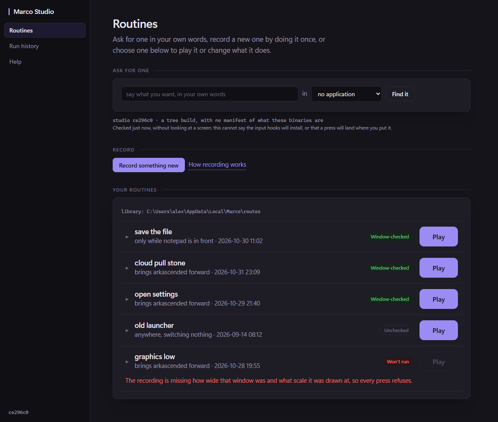
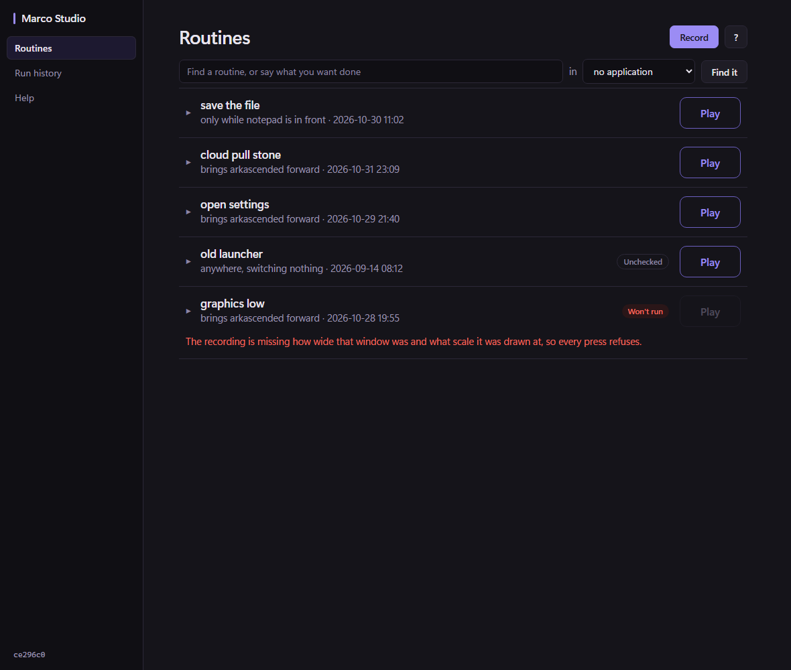
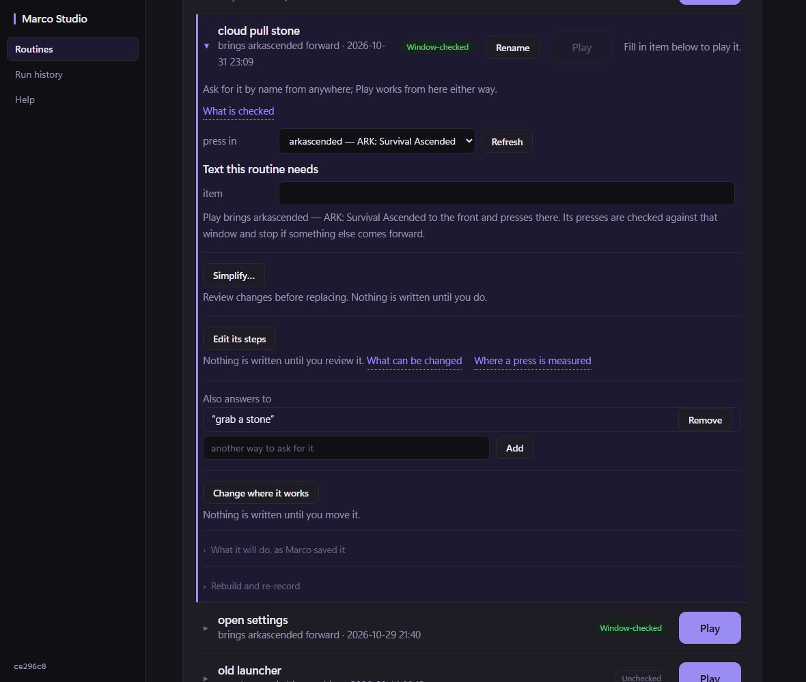
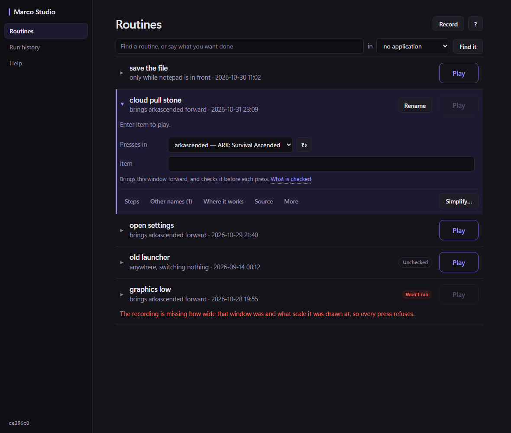
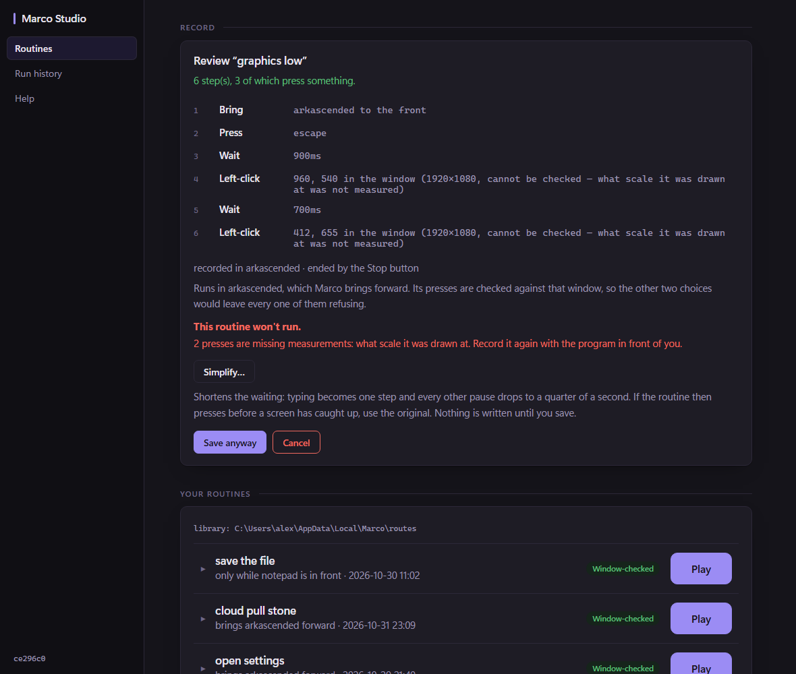
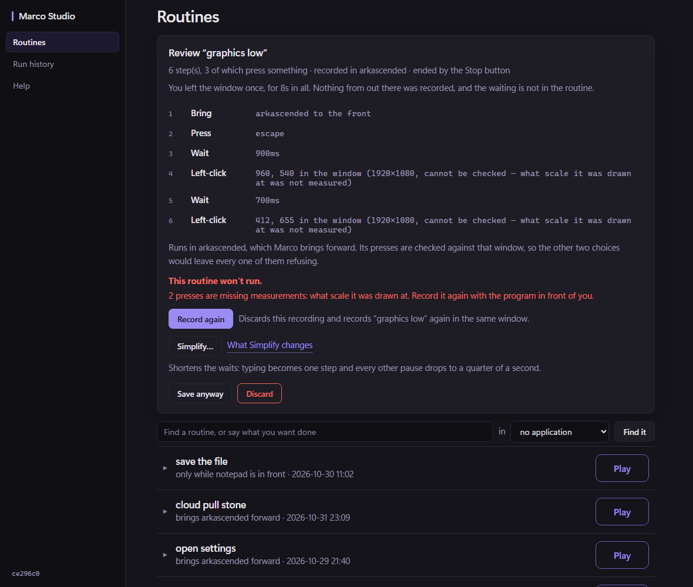
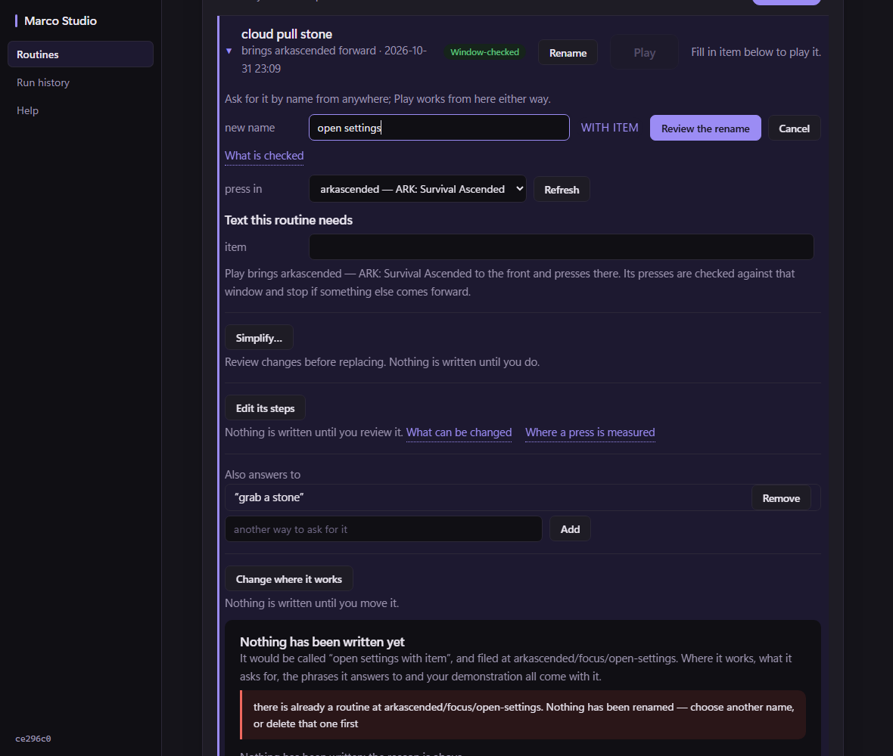
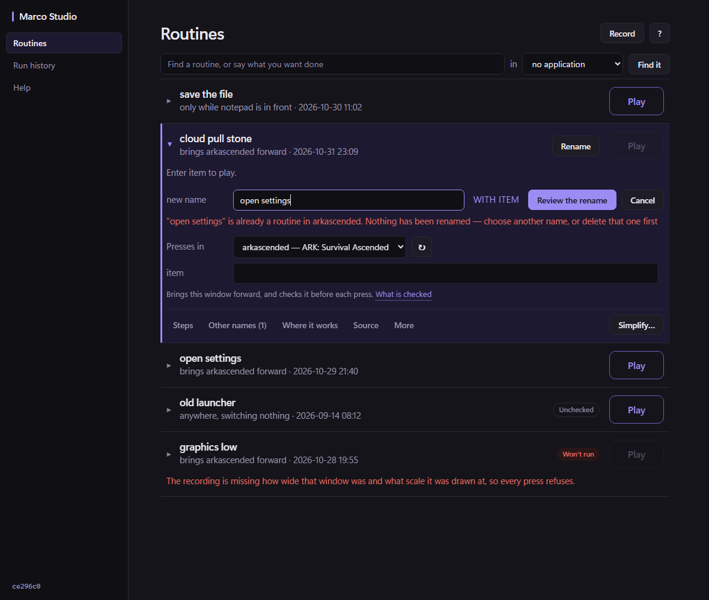
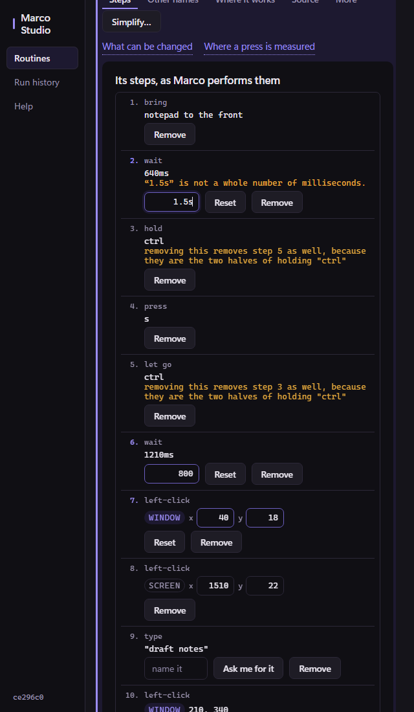
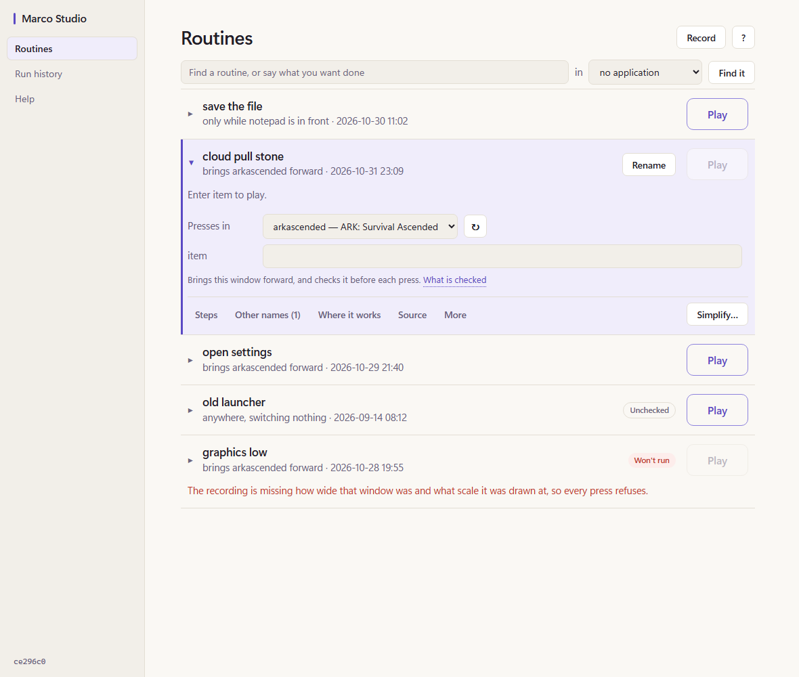

# Studio coherence — what was implemented, measured against the audit

[[Studio-coherence-audit-2026-11-02]] is the before record and is left as it was. This note is
the after record. It covers what the Architect approved, the four increments, the same
measurements taken on the same fixtures, and what was not established.

## What was approved

The library-first layout and the compact expanded routine were approved, with these rulings:

- **Routine** is the user-facing noun; Record creates one and Play executes it.
- **Outlined Play on collapsed rows**, at the current size. Record is secondary while a routine
  is open.
- **Tabs** in the expanded routine, with Rename beside the name and **Simplify… directly
  visible**.
- Build information, paths and provenance move to Help or Details. Problems, library conflicts
  and refusals stay visible.
- Four bounded increments.
- Two corrections to the mockups:
  - *Enter item to play.* replaces the directional wording;
  - Simplify's consequences belong in the review, not in a tooltip.

## The increments

| | Commit | ADR | What changed |
|---|---|---|---|
| — | `e05ff2a` | — | the audit, committed as the before record |
| 1 | `ecc5f03` | [[ADR-292-the-boxes-are-the-change]] | The step editor has no Set. Typed values are collected at Review. Invalid input is kept as typed, with a row error and nothing sent. A stale review is withdrawn. |
| 2 | `ec09320` | [[ADR-293-feedback-the-window-had-and-did-not-give]] | `away` shown. Confirmation lines span the row. A rename refusal appears beside the box, and the collision names the routine. The selector is never empty. Play is dark during a recording. *Enter item to play.* |
| 3 | `10603eb` | [[ADR-294-the-library-is-the-screen]] | Header, find box, list. An open routine is a run strip plus tabs, with Simplify visible. One filled button. 4.5:1 contrast. Help gains About, Simplify and Other names. *Routine* in Studio, the overlay and the README. |
| 4 | `474b143`, `c9e683e` | [[ADR-295-a-recording-that-wont-run-is-recorded-again]] | Record again is primary for a won't-run recording: it discloses the discard, keeps the setup and revalidates the window. Simplify's cost is stated where it is approved. One summary line. |

Each increment ran `go test` for `plugins/studio` in full, and every new test was checked by
deliberately breaking the code it guards and confirming it fails: 22 mutations across the four
increments, all caught. The root suite (`go build ./... && go test ./...`) passed after the last
increment, as did the overlay module's tests, `docscheck` and `internal/wiringcheck`.

## Measured, before and after

The same headless harness, the same fixtures in the backend's wording, at 1180×1000, dark theme.
*Before* is the page at `ce296c0`. *Filled* counts visible buttons whose computed background is
the accent, not buttons carrying the `go` class, because a shut row's Play keeps the class and is
drawn outlined.

| State | Words | Prose | Buttons | Filled | Scroll height |
|---|---|---|---|---|---|
| Empty library | 103 → **24** | 67 → **14** | 3 → 3 | 1 → 1 | 908 → 908 |
| Library | 162 → **80** | 81 → **25** | 13 → 13 | 5 → **1** | 1038 → **908** |
| Routine open | 267 → **105** | 150 → **35** | 22 → 22 | 5 → **1** | 1693 → **908** |
| Record setup | 251 → 174 | 164 → 108 | 15 → 15 | 5 → 1 | 1396 → 996 |
| Recording | 182 → 141 | 117 → 84 | 13 → 13 | 5 → 1 | 1180 → 963 |
| Review | 295 → 201 | 195 → 119 | 14 → 15 | 5 → 1 | 1640 → 1204 |
| Review, won't run | 316 → 259 | 191 → 150 | 14 → 16 | 5 → 1 | 1635 → 1273 |
| Arguments required | 280 → **111** | 157 → **39** | 23 → 22 | 4 → **0** | 1827 → **908** |
| Run confirmation | 282 → **116** | 152 → **37** | 25 → 24 | 6 → **1** | 1996 → 965 |
| Step editor | 406 → **241** | 174 → **51** | 39 → 37 | 5 → 1 | 2397 → 1503 |
| Rename collision | 368 → **139** | 217 → **61** | 27 → 24 | 5 → 1 | 2222 → 932 |
| Help, one section open | 108 → 152 | 72 → 98 | 0 → 0 | 0 → 0 | 908 → 928 |

Notes on the table:

- **Arguments required shows no filled button.** Play waits on the field, and the line says
  *Enter item to play.*
- **The confirmation shows one: *Run it*.** It first showed two, because the open routine's
  Play was repainted live and filled as soon as the review came back. That was corrected by
  ruling in a separate commit: while a confirmation can be run, Play is unavailable. A refused
  confirmation has no *Run it*, so Play stays filled as the way to ask again. See the correction
  in [[ADR-294-the-library-is-the-screen]].
- **Help grew, as intended.** It now carries About this installation, which is what left the
  Routines screen.
- **The won't-run review gained three things it lacked:** the `away` line the backend always
  sent, Record again, and Record again's disclosure.

## Renders

All 17 states at both widths, dark, are in `docs/images/studio-ui/10-impl-dark-*.png`. Seven
states in the light theme are in `10-impl-light-*.png`.

| Before | After |
|---|---|
|  |  |
|  |  |
|  |  |
|  |  |

The narrow step editor, with a wait typed as `1.5s`, a corrected wait and a moved press:

The light theme:

New states that had no before:

| File | What it shows |
| --- | --- |
| `10-impl-dark-14-editor-typed-*` | typed and invalid input with its row error |
| `10-impl-dark-15-tab-names-*` | a tab open |
| `10-impl-dark-16-help-about-*` | About this installation |
| `10-impl-dark-17-review-simplified-*` | a simplified review that names the value it took off |

## Against the audit's acceptance criteria

| A person can… | Result |
|---|---|
| see their routines without scrolling | **Met.** The first row starts at about 157px, against 549. |
| tell the one next action | **Met.** One filled button, including at the run confirmation, where it is *Run it*. While a required value is empty there is none: Play waits on the field and says so. |
| open a routine and play it without scrolling past maintenance | **Met.** Window, value and Play are in the first ~150px of the open panel. Prose is 39 words on the whole screen. |
| see an editor appear where they asked | **Met.** The panel sits directly under the tab row. |
| change a coordinate and have it count | **Met.** `TestTypedStepValuesAreReviewedWithoutASetAndAreNeverDropped` |
| learn a name is taken where they typed it | **Met.** The refusal is directly under the name row and names the routine. |
| recover from a won't-run recording in one press | **Met.** Record again is primary. |
| understand why a recording is shorter | **Met.** `away` is shown. |
| read every label | **Met.** `TestEveryTextTokenMeetsContrastOnEverySurface` covers both themes. |
| trust nothing is lost by accident | **Met.** Refusals, the leave warning, the pair consequence, the paused line, `again_elsewhere` and the confirmation all render. Input survives tabs, redraws and a refused leave. |
| meet one vocabulary | **Met for Studio, the overlay listing and the README.** `marco plays`, `--play=`, `no play matches` and the web UI's *Plays* tab are unchanged, by ruling. |
| scan a smaller screen | **Met.** No horizontal scroll at 640px in any of the 17 states. |
| read less to act: idle library ≤ 30, open routine ≤ 60, ordinary review card ≤ 70 | **Two of three met.** The library is 25 and the open routine 39. **The ordinary review card is 88 words of prose (107 before), which misses the target.** See below. |

**Why the review card misses.** Most of what remains is two backend sentences these increments
did not touch:

- `exit`, 27 words: *The alt+tab you used to leave the window…*
- `brings`, 26 words: *Runs in notepad, which Marco brings forward. Its presses are checked…*

The rest is the Simplify consequence the ruling asked to keep in the review. The audit's stage 4
proposed shortening `brings`. That is backend copy and was not part of the approved increments.

## Decisions taken inside the rulings

| Decision | Reason |
| --- | --- |
| **The won't-run refusal stays below the steps.** | The mockup put it at the top. The review card has been held, by a test, to showing the demonstrated steps first; that ordering was not part of this ruling, so it was not reopened. |
| **Record again starts recording when the window is still there.** | The form opens only when there is a choice to make again. |
| **Pressing the open tab closes it**, except Steps and Where it works when nothing is loaded yet. | For those two, the press is the request to load. |
| **The window line is composed on the page from `contract`**, the same fact the backend's sentence uses. | The full backend sentence remains the chooser's title. |
| **Audit finding 22 was not implemented**: hiding the library while a recording is reviewed. | It was not in the approved increments, and the Architect ruled it stays out of this slice. Play is dark during a recording (increment 2), but the library's Play is still live during review. |
| **The review card's 88 words are accepted.** | By ruling: useful consequences are not removed only to reach 70. |
| **Typing a new value while a confirmation is up does not withdraw it.** | Play stays unavailable until *Run it* or Cancel. *Run it* is confirmed by token alone, so it types the values shown on the card, not what is in the box. |

## Two things that went wrong during the work

**A plain `go build ./...` inside `plugins/studio` overwrote `plugins/studio/studio.exe`.** That
module is a single main package, so Go wrote the binary into the directory, and without Wails'
`production` tag it is the build that opens no window. It was found after the fact by comparing
binary timestamps. It was restored by copying back the windowed `studio.exe` that `build.cmd` had
placed at the repository root from the same build. The two are now byte-identical, and the
check CLAUDE.md gives (`grep -a "will not build without the correct build tags"`) finds nothing
in either. No other binary was touched. It is recorded so it is not repeated. The restoration
returns the previous build; it establishes neither a new build nor anything on the desktop.

**The audit's headless renders did not run CSS transitions.** A button whose class changed after
the first paint could be photographed in its old colour: the computed style stayed at the
transition's start under virtual time. The harness now forces `prefers-reduced-motion`, which the
page already honours by turning transitions off. Every after-render above was taken with it. The
audit's word counts are read from the DOM and are unaffected. Its before-images of states with
such a change may show a button's previous fill.

## Not established

- **No desktop.** Studio was not launched, closed or rebuilt; no input was injected; the owner's
  library was not read.
- **Two desktop scenarios press controls by id and were not run.**
  - `plugins/e2e` `scenario_generation` presses `routineMaintainSummary`, now the More tab. It is
    a button with the same id, and its panel is still `routineMaintain`.
  - `scenario_simplify` presses `routineSimplifyBtn`, now always visible in the tab row.

  Both ids were kept for exactly this reason. Stage 5 of `gate.ps1` is what would establish it.
- **The overlay's listing text was changed and its tests pass.** The HUD was not looked at.
- **The light theme was rendered headlessly at device scale 1.** The owner's DPI and font
  rendering were not seen.

## Reproducing

The harness, fixtures, state scripts and the proposal overlay are in
`docs/images/studio-ui/9-harness/`:

1. Build `harness.go.txt` as `main.go` in a scratch module.
2. Run `render-impl.sh <outdir> <dark|light> states/*.js` from that directory.
