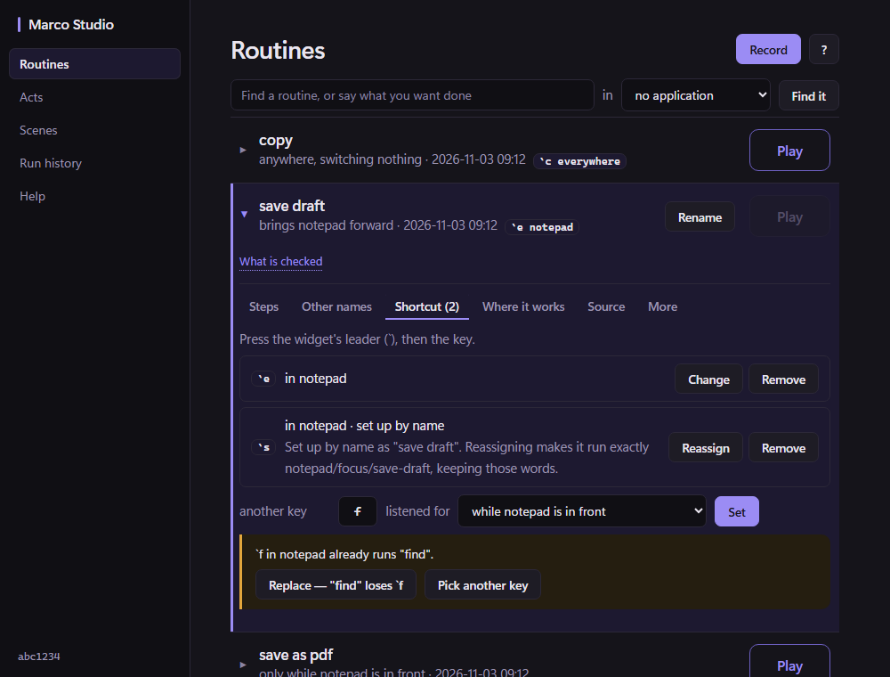
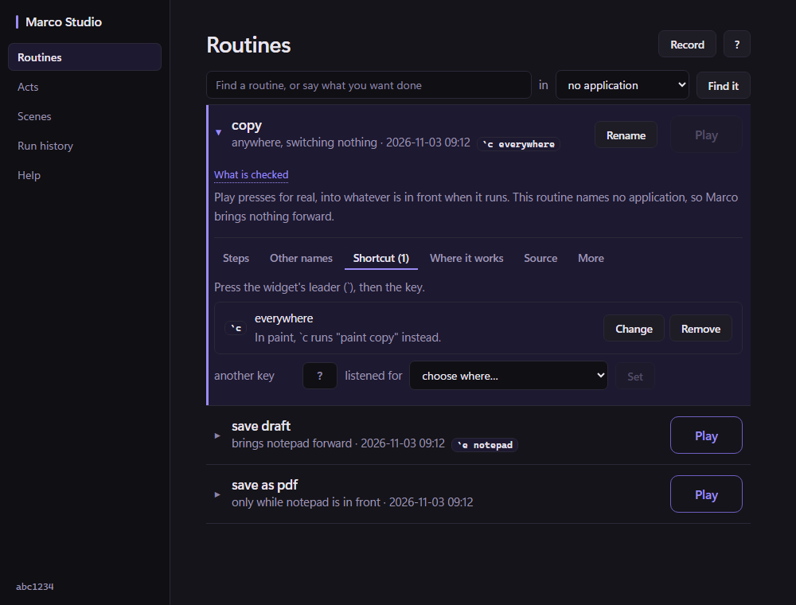
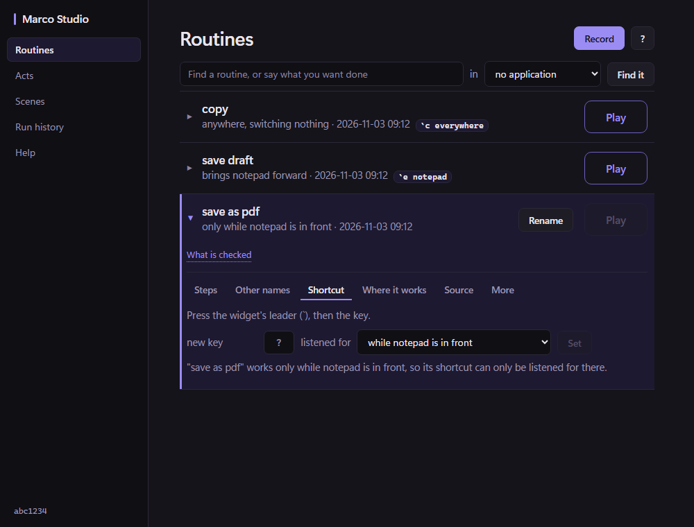

# Studio sets shortcuts through the one owner

S3 of [[Surfaces-alignment-proposal-2026-11-02]], on the owner built in
[[ADR-297-a-shortcut-names-its-routine-and-has-one-owner]]. S2 and S3 are separately reviewable:
this record changes Studio and adds two small things to the owner, named below.

## What was asked

Show the configured leader and the assigned key on the routine; Set, Change and Remove; choose
application-specific or global availability where allowed; collisions inline with version-bound
replacement consent; legacy bindings visibly reassignable; and the replacement confirmation saying
that existing shortcuts are kept.

## What was decided

- **A Shortcut tab, beside Other names**, built the same way: the backend's answer is the only
  thing drawn, read back off disk after every change. It loads when the tab is opened, not when a
  routine is, so it stays downstream of Play (the reason the phrase panel's call is last).
- **Where it is listened for is stated.** Studio is in front whenever somebody uses it, so "the
  application in front" would be Studio (R4). Places come from the backend: the routine's
  application (offered first), everywhere, and an application the person names. Whether everywhere
  is allowed is the owner's `wider` rule, reached through `orchestrator.WiderThanItsRoutine`. For an
  Only-in routine both other places are shown as unavailable with one sentence, once.
- **A key in use is shown, not replaced.** `SetShortcut` with no consent onto a taken key writes
  nothing and returns `Taken` with what it runs and its binding version. The page's Replace sends
  that key, that place and that version, not whatever the form says by then. The owner checks the
  version again under its lock.
- **A Change is one write.** `orchestrator.Assignment.Changing` names the shortcut being changed,
  as the version shown; the owner removes it in the same `UpdateBindings` write that adds the new
  one, and refuses everything if it is gone or changed. A change can never leave both keys, or
  neither. A change keeps the binding's words, so configured values survive.
- **Remove** sends the version of the row it was pressed on.
- **A shortcut set up by name** is listed on every routine its words name, as *set up by name*, with
  the exact identities a reassignment would make it run (the step naming this routine is this
  routine; any other step is what its words reach in the application it is listened for in).
  Looking at it changes nothing. Reassign sends the version and that plan, and is refused if the
  words now reach anything else.
- **The routine row** carries its keys as chips, as they are pressed (`` `e notepad ``).
- **The Replace card** says the routine's shortcuts are kept and will run the new version, naming
  them with the leader, or says the shortcuts file could not be read. Never "none" for unknown.
  `orchestrator.Collision.ShortcutsUnknown` carries that.
- **The leader** is read by `internal/widgetconfig`, read-only, with the widget's own precedence
  (default, then `$MARCO_OVERLAY_LEADER`, then the file's `leader`). The CLI's `configuredLeader`
  uses it now too; it previously ignored the environment. The writer that preserves unknown fields
  is still S5.
- **While Studio records**, nothing on the tab can be changed (the same hold-off as the phrase
  panel). An unreadable shortcuts file is said and nothing is offered over it.

## Owner additions (S2 code, reviewable on their own)

`Assignment.Changing` and `Slot` (the one-write change); `WiderThanItsRoutine` (the `wider` rule,
exported); `Collision.ShortcutsUnknown`. Nothing else in the owner changed.

## Rendered layout

Rendered in headless Edge from `plugins/studio/testdata/shortcutspage.js`, the same stub the page
test uses, in three states: a key in use (the inline banner, Replace and Pick another key), a
global routine (no default place, and the line saying where an application's key hides it), and an
Only-in routine (everywhere unavailable, one reason). Accepted by the owner on 2026-11-03 as
supporting the intended assignment flow.

| a key in use | a global routine | an Only-in routine |
|---|---|---|
|  |  |  |

## Enforced by

- `plugins/studio` backend, against a real library: `TestTheShortcutTabOffersTheLeaderAndTheRoutinesOwnApplicationFirst`,
  `TestAKeySetInStudioIsWhatAPressRuns`, `TestAKeyInUseIsShownAndReplacedOnlyWithItsVersion`,
  `TestAChangeInStudioMovesTheKey`, `TestRemovingInStudioNeedsTheVersionShown`,
  `TestAnOnlyInRoutineIsNotOfferedEverywhere`, `TestAShortcutSetUpByNameIsReassignedOnlyOnRequest`,
  `TestTheShortcutTabHoldsOffWhileRecording`, `TestAnUnreadableShortcutsFileIsSaidAndNothingIsOffered`,
  `TestAGlobalShortcutSaysWhereItIsHidden`, `TestTheReplaceQuestionSaysItsShortcutsAreKept`.
- `plugins/studio` page, rendered: `TestTheShortcutTabDoesWhatItShows` (29 claims, one counter
  each), `TestTheReplaceCardSaysItsShortcutsAreKept`,
  `TestTheReplaceCardSaysNothingAboutShortcutsItDoesNotHave`, `TestTheReplaceCardSaysWhenItCannotTell`.
- `internal/orchestrator`: `TestAChangeMovesTheShortcutInOneWrite`,
  `TestAChangeOfWhereItIsListenedFor`, `TestAChangeOfAShortcutThatChangedWritesNothing`,
  `TestAChangeOntoATakenKeyNeedsConsent`, `TestAChangeOfAShortcutThatHasGoneIsRefused`.
- `internal/widgetconfig`: `TestTheLeaderIsReadTheWayTheWidgetReadsIt`, `TestAShortcutReadsWithItsLeader`.

Mutations, all killed: Replace sending the form instead of the banner; a routine about no
application given a default place; a Change sending no version; a reassignment sending no plan; the
typed key cleared on a refusal; the backend skipping the key-in-use check; everywhere always
allowed; the plan comparison skipped; the recording hold-off skipped; an unreadable file read as
empty; the card's keys without the leader; the owner's Change ignoring a changed version and
accepting a gone one; the card's kept sentence and its could-not-be-read sentence each removed.

Survivor, kept on purpose and said: the tab's own "belongs to the routine on screen" guard is the
second of two (the redraw also drops the state when the routine changes), so deleting either one
alone is not seen by any test. The phrase panel has the same pair and says the same.

## Not established

- No desktop run, by instruction: every result is from headless renders and synthetic libraries,
  on Windows only.
- The key box takes one character. A leader shortcut on a named key (F-keys, Tab) is not offered
  from Studio; nothing in the owner refuses one, and the CLI can still set it. **Needs a later
  key-capture improvement.**
- An application named for "while an app you name is in front" is free text; it is not checked
  against anything running. **Ruled acceptable** (2026-11-03): a shortcut may be configured before
  its application is running.
- Shortcuts set up by name that name no routine in the library, and identity shortcuts whose
  routine has gone, are not shown in Studio at all (they have no routine to be shown on); `marco
  bindings` lists them. **Stale bindings need a management view beyond individual routine cards.**
- [[Experiment-099-two-activation-failures-for-one-absent-application]] remains unresolved,
  although its test passed in this boundary's run.
- The Linux `go vet` failure (S2) and the unresolved engine failure
  [[Experiment-099-two-activation-failures-for-one-absent-application]] are unchanged by this.
