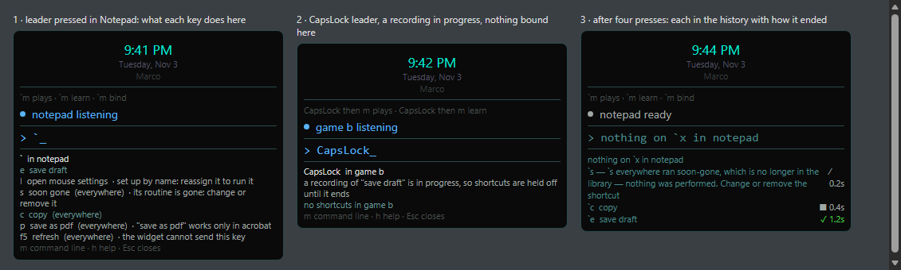

# The widget explains its keys

S4 of [[Surfaces-alignment-proposal-2026-11-02]], on the owner of
[[ADR-297-a-shortcut-names-its-routine-and-has-one-owner]]. It closes finding F9 (a hotkey run left
no status line and no history row). F6, one meaning for Enter, was listed under S4 in the proposal
and is **not** part of this change.

## What was asked

Show the shortcuts when the leader is pressed; use the configured leader in the echo; explain
unbound and stale keys; record hotkey outcomes in history. Reuse S2's listing and execution
decisions; keep application overrides, cancellation and the recording stop; keep the two-second
arm; fetch listings off the hook thread.

## What was decided

- **The list is the engine's listing, worded.** On the leader, the action loop starts
  `marco bindings --here --armed-in=<app> --json` on a goroutine of its own (`startArm`) and
  returns. The hook only pushes an action, as before. The listing is of the application the leader
  was pressed in (see below) and lists its keys first and the globals they do not hide. The widget
  words each row and decides nothing about it. `TestTheArmListIsWhatAPressWouldFire` holds
  the listing and the press together key by key, through the production functions.
- **Help, never a gate.** The arm is still two seconds (`armWindow`, which the controller's
  `leaderTimeout` now is). The listing is bounded by the same two seconds and reaped. A key works
  whether the list has arrived or not. A list that arrives for a press that has gone (the key after
  it, Esc, the timeout) is dropped by its press number, under that press or a later one.
- **A listing that cannot be had is said as that**: did not arrive, could not be listed (an engine
  with no `bindings`, such as the stale binaries this tree still has beside it), could not be read.
  Never "no shortcuts".
- **What each mark means.** `(everywhere)` is where a key is listened for. A ` · ` mark means it
  does not run as listed: set up by name, reassign it; its routine is gone, change or remove it;
  the engine's own sentence for a key wider than its routine; and the widget cannot send this key,
  for a shortcut on a key the controller never passes on (anything but one letter or digit, and
  `m`/`h`, which it keeps).
- **A recording holds shortcuts off, and the list says so**, from the press's own reading
  (`heldOff` in `cmd/marco`, the press's sentence without "nothing was performed").
- **Nothing on a key is said.** `marco hotkey` with nothing bound used to be silent. It now prints
  ``nothing on `x in notepad`` (with the configured leader) and announces no `[result] `, because
  nothing was invoked and none of the seven words is true of it. The widget reads "exited cleanly
  and announced nothing" as exactly that, and says it in its own words if an older engine said
  nothing.
- **A pressed shortcut is tracked** (`pressShortcut`): status line, history row with the routine
  the engine announced or the engine's sentence, the time, and a log line. It is still registered
  for cancellation, so the leader while it runs stops it as before.
- **The session is bound to the application in front at the leader** (added at the owner's
  review, before commit). The first version read the foreground twice, once for the list and once
  for the press, each in its own process. Each reading was correct, and together they were wrong: the list
  could show `e  cloud pull stone` for one application and, with another brought forward before
  the key, the press ran that application's `e`. Now the action loop reads the foreground once at
  the leader (`frontApp`, which is the engine's own `winctx.Active`, so the names agree). The list
  is asked for that application (`marco bindings --here --armed-in=<app>`), and the key carries it
  to the engine (`marco hotkey <key> --armed-in=<app>`). The engine compares it with the
  foreground it reads itself **before selecting any binding** (`pressArmed`). If they differ,
  nothing runs, the outcome is refused, and the sentence names both and asks for the leader again:
  `` `e was pressed for discord, and notepad is in front now — nothing was performed; press ` again ``.
  The key does not wait for the list. The Hotkeys event still carries the key alone, because a
  person's own `overlay.marco` may bind that feed. So the context goes beside it, one entry per
  press, oldest first, and an entry that no press takes expires after five seconds
  (`carryPress`/`takeCarried`). A press that no leader carried (a script calling `Overlay Hotkey`
  or `marco hotkey`) runs in whatever is in front, as before.
- **The leader is the key the hook listens for.** `widgetconfig.Named` now mirrors the widget's
  `parseLeader` spelling for spelling, including its fallback to the backtick for a setting it does
  not recognise. Studio and the CLI use the same function, so they show it the same way.

## Rendered layout

A mockup, not a render of the HUD: ebiten cannot draw without opening a window, and no window is
opened here. It uses the widget's default theme at its default width, and its text is the exact
output `TestTheArmListIsTheEnginesAnswer`, `TestTheArmListSaysWhatHoldsShortcutsOff` and
`TestAPressedShortcutIsInTheHistory` assert. The two-space gaps are the HUD's own.

## Enforced by

- `cmd/marco`: `TestTheArmListIsWhatAPressWouldFire`, `TestNothingOnAKeyIsSaidWithTheConfiguredLeader`,
  `TestTheArmListSaysARecordingHoldsShortcutsOff` (Windows: the recording fact identifies a process).
- `plugins/overlay`: `TestTheArmListIsTheEnginesAnswer`, `TestTheArmListSaysWhatHoldsShortcutsOff`,
  `TestAListThatCouldNotBeHadIsNeverNone`, `TestTheArmListIsFetchedOffTheActionLoop`,
  `TestAListForAPressThatHasGoneIsNotShown`, `TestTheArmStaysTwoSeconds`,
  `TestTheEchoIsTheConfiguredLeader`, `TestAPressedShortcutIsInTheHistory`,
  `TestAPressedShortcutCanStillBeStopped`, `TestAQuickKeyDoesNotWaitForTheList`,
  `TestALateListIsNotShownUnderALaterLeader`, `TestOnlyALeadersOwnKeyCarriesItsContext`,
  `TestTheListIsOfTheApplicationTheLeaderWasPressedIn`; Windows: `TestTheLeaderIsShownAsTheKeyItListensFor`,
  `TestTheLeaderIsArmedForTwoSeconds`, `TestTheActionLoopShowsTheListAndPutsItAway` (the
  production action loop, entered through `processFrom`), `TestAKeyIsForTheApplicationItsLeaderWasPressedIn`.
- `cmd/marco` (the context): `TestAKeyPressedAfterTheFocusMovedRunsNothing`,
  `TestAKeyPressedWhereTheLeaderWasPressedRuns`, `TestTheCarriedApplicationIsWhatIsReadFromTheArguments`.
- `internal/widgetconfig`: `TestAShortcutReadsWithItsLeader`.

Mutations, all killed (18): the fetch moved onto the loop; the press number dropped; a listing
failure read as empty; the press back on `runMarco`; the press without cancellation; the echo
written as a backtick (in `arm.go` and in the loop); `Named` showing a setting as typed; the CLI's
nothing-on sentence removed; `held` left out of the listing; every key sendable; a three-second arm
(in `arm.go` and the controller); the nothing-on row read as performed; the stale mark removed;
the loop not starting the list, and not putting it away after a key or the command line.

The context, 13 more runs: the loop carrying nothing, and the loop reading the foreground at the key;
the press dropping what was carried; the list read for the foreground at the listing, and asked
without the context; the session started with no application; the press number dropped again;
carried presses that never expire, and the newest taken instead of the oldest; the engine's
comparison removed; `--armed-in` not making a list "here", and not marking a press as carried.
Twelve killed. One survived and is equivalent: the engine passing the carried application instead of the
foreground into the press, after checking that the two are equal.

## Not established

- **No desktop run and no rebuild**, by instruction: the HUD itself was not drawn, the hook was not
  exercised by real keys, and the binaries beside the tree are older than this change (they have
  no `marco bindings`, so a widget run against them would say *the shortcuts could not be listed*).
  Windows only.
- Whether the list arrives inside the two seconds on a real machine is not measured. The child is
  one `marco` start and a library read; if it is slower than the arm the person sees no list and
  the key still works.
- The context is the application, not the window: two windows of one application share its
  shortcuts, so moving between them is not refused. The application is named by `winctx.Active`,
  the engine's own reading, in the widget's process. An engine older than this change ignores
  `--armed-in` on a press (it would run unchecked) and refuses it on a listing, so the widget would
  say the shortcuts could not be listed. The binaries beside the tree are older than that.
- Recorded at the owner's instruction: during this change's compile checks `go build ./cmd/marco/`
  without `-o` overwrote the repo-root `marco.exe`, and it was restored from
  `plugins/studio/marco.exe`. The restored file is **byte-identical to the surviving sibling,
  original identity unproven**. `build.cmd` writes both copies from one build, which is the only
  reason to believe they matched. The mismatched-stack warning (root `director.exe` 2026-11-03
  01:30 against `marco.exe` 2026-11-02 23:10) stands.
- The refusal sentences the engine already had (set up by name, routine gone, changed while
  pressed) still write the backtick, not the configured leader. Only the new sentence uses it.
- F6 (Enter) is not touched.
- **The boundary run FAILED one test outside this change's dependencies**: `cmd/director`
  `TestAGrantedRunAsksNobodyAnything`, *the run could not establish its screen and never said so*,
  the open intermittent failure of [[Roadmap]] 38, recorded there with the full output and not
  re-run. Everything else passed (116 engine packages including `cmd/marco`, Studio, the overlay).
  Experiment-099's test passed in this run, which resolves nothing.
- **After the context fix, only the affected checks were run** (by instruction, not the full suite
  again, so the boundary's Roadmap 38 failure stands as recorded): `cmd/marco`, `widgetconfig`,
  `winctx`, `navsource`, `wiringcheck`, `spectest` and the whole overlay module passed, as did
  `go build ./...`, gofmt and docscheck. Windows only. Outputs are in
  `docs/experiments/Roadmap-38-output/2026-11-03-s4-context-{engine,overlay}.txt`.
- Unchanged: the Linux `go vet` failure (S2) and
  [[Experiment-099-two-activation-failures-for-one-absent-application]].
