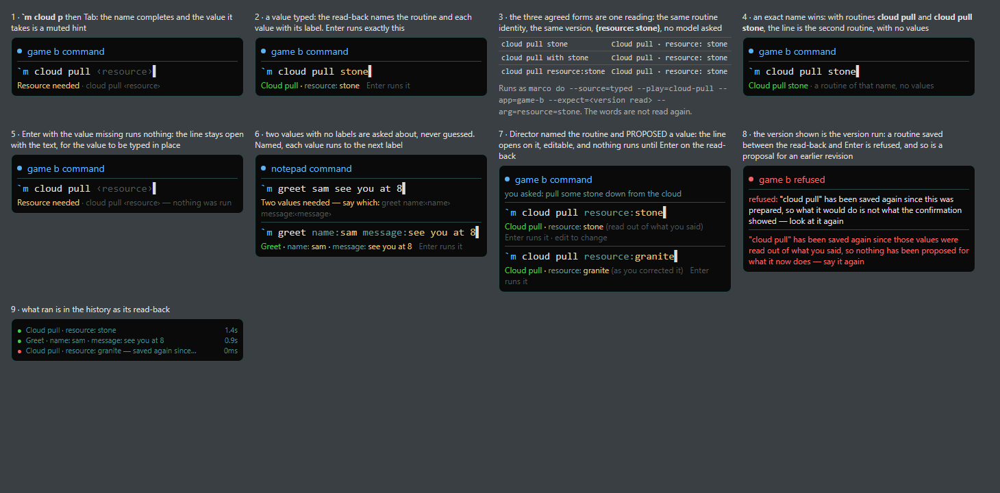

# The command line reads back what it will run

S6 of [[Surfaces-alignment-proposal-2026-11-02]] (§5.4, §6.4, §7.6). The flow was rendered before it
was built: `docs/images/widget/s6-argument-entry-flow-mockup.png` (from the `.html` beside it). It is a
mockup, not a render of the HUD, because ebiten cannot draw without opening a window.

## What was asked

Show `cloud pull ‹resource›` as a command hint; accept the three agreed deterministic forms; keep
exact-name precedence; let missing values be completed in the widget; give LLM-proposed values an
editable review and confirmation; keep the explicit routine identity and source-version binding
throughout.

## What was decided

- **The engine reads the line; the widget draws the reading.** `marco line --json [identity and
  proposals] -- <line>` runs nothing and writes nothing (`readLine`). The widget asks it off the hook
  thread and off the action loop, once the line has settled (`pollLineReading`), and draws only a
  reading for exactly the line on screen. The line goes after `--`, so nothing typed is read as a
  flag.
- **The order** (`lineRoutine`):
  1. The exact name. `cloud pull stone` is the routine of that name and has no values.
  2. The intake's existing grammar, `name:value` and ` with a, b`, unchanged.
  3. New, only here: the longest leading run of words naming a routine that takes a value, with
     the rest of the line as typed as the value. This applies only when the routine takes ONE
     value. With several, the line says *Two values needed — say which: greet name:‹name›
     message:‹message›* and runs nothing. A line carrying a label that names nothing is not read
     this way, because the label would become part of the value.
  4. Otherwise nothing. The line goes to the intake as words, and Director reads it as before.

  Step 3 is not part of `marco do`. Spoken and scripted phrases keep the intake's own grammar, and
  this command line is the one place the read-back is on screen before anything runs.
- **What Enter runs is the read-back's identity and version** (`lineRunArgs`): `--play`, `--app`,
  `--focus`, `--expect=<source_at>` and one `--arg` per value. The intake's explicit-identity arm
  never reads the words again, and the door refuses a routine saved since. That is `Expect`, the
  same binding Studio's confirmation uses. **Enter runs only a read-back that has been on screen,
  for exactly that line, for at least 300 ms** (`readDwell`). A first Enter that arrives before
  that shows the read-back, says *Enter runs it*, and runs nothing.
- **A missing value** (*Resource needed · cloud pull ‹resource›*) runs nothing. The command line
  reopens on the text for the value to be typed in place.
- **The read-back is the engine's** (`PrepareProposed`, through `partsOf` and `readbackOf`). Each
  value appears with its label, so colour never carries the meaning alone. A credential-store
  value is shown as *from the credential store* and is never a value on this line. A value given in
  order that would land on one is refused rather than dropped.
- **What Director proposed is reviewed, not supplied** (`reviewProposal`). When nothing took a
  phrase and Director names a routine that takes values, the command line opens on that routine
  with the proposals written in as `name:value`. The reading is asked with the identity, the
  proposals and the revision they were read from, so:
  - a value left alone reads *(read out of what you said)*;
  - a value the person changed reads *(as you corrected it)*;
  - a proposal for an earlier revision refuses.

  The engine compares; the widget only says what it offered. The review opens only if the line
  reads as the routine Director named. Otherwise it stays the plain offer, and no proposal is
  attached to another routine. A line edited to name another routine drops the proposals. A
  routine that takes no values is still the plain *Run …? [y]es / [n]o* offer.
- **Every other line is unchanged.** That covers a routine with no values, a line naming nothing,
  a control word (never kept waiting for a reading), anything spoken, and an engine with no `line`.
  All of these go to the intake as words.
- **The command line types what a value needs**: `: ; , . / ' " = + [ ] \`, and the shifted digits,
  in the hook, as a switch with no I/O (`vkToText`). This applies to the command line only: the
  key after the leader still reads `vkToRune`, so a punctuation key there is not a shortcut. The
  table is for the US layout.

## Enforced by

- `cmd/marco`: `TestTheThreeFormsAreOneInvocation` (same identity, version and value, and running
  it through `parseDoArgs` and the door types it), `TestAnExactNameWinsOverATemplate`,
  `TestAMissingValueIsAskedFor`, `TestSeveralValuesWithoutLabelsAreAskedAbout`,
  `TestASecretIsNeitherAskedForNorTyped`, `TestAValueInOrderNeverLandsOnASecret`,
  `TestALineThatNamesNothingIsLeftToTheIntake`, `TestTheBareFormIsARoutineThatTakesAValue`,
  `TestAProposalIsReviewedNotSupplied`, `TestARoutineSavedAfterTheReadBackIsRefused`,
  `TestTheLineIsReadAfterItsFlags`, `TestAProposalForAFocusRoutineIsNotReadOnItsNamesake`.
- `plugins/overlay`: `TestAReadBackRunsAsItsIdentityAndVersion`, `TestNothingWithAValueRunsUnread`,
  `TestAReadBackThatJustArrivedHasNotBeenRead`, `TestOtherLinesGoToTheIntakeAsBefore`,
  `TestAProposedValueIsReviewedBeforeItRuns`, `TestAReviewIsOnlyOfTheNamedRoutine`,
  `TestARoutineWithNoValuesIsStillOffered`, `TestTheLineIsAskedOfTheEngine`,
  `TestAReadingIsShownOnlyForItsLine`, `TestALateReadingDoesNotReplaceTheCurrentOne`,
  `TestAProposalForTheFocusRoutineIsNotPutOnItsNamesake`, `TestALineEditedAwayFromItsProposalRunsNothing`,
  `TestASuppliedValueNeverReachesTheLog`; Windows:
  `TestTheCommandLineTypesWhatAValueNeeds`.

Mutations, 23 in all and all killed. The six below survived their first run, and a test was added
for each:

- **Engine (9):** dropping the exact step; guessing several unlabelled values; applying proposals to
  another routine; dropping the missing check; letting an ordered value land on a secret; a longer
  name that takes no value capturing the line *(survived first)*; a labelled line falling into the
  bare form *(survived first)*; ignoring the contract's refusal; reading flags after `--`.
- **Widget (14):** running unread; dropping `--expect`; sending words instead of the identity;
  dropping the dwell *(survived first)*; reading spoken lines; keeping control words waiting; skipping
  the review; dropping the proposal's version; a late reading replacing the current one *(survived
  first)*; drawing a reading under another line; a proposal outliving its run; taking an answer
  about another line; reviewing on a routine Director did not name *(survived first)*; losing the
  colon.

## Corrected before commit (owner review)

Two P1s from the owner's review, fixed before S6 was committed:

- **The review compared only part of the identity.** It checked the application and the name, and
  a context routine and a focus routine share both. So Director could propose the focus one while
  the line read as the context one. The engine then dropped the proposals and the values read back
  as typed. Now the WHOLE identity (application, scope, name) is compared in three places:
  - `sameRoute` in the widget, before a review is opened: a namesake refuses, the HUD says
    which routine was proposed and which the line is, and nothing is offered or run;
  - Enter, while a proposal is on the line: a line edited to name another routine runs nothing
    until it is dismissed, and dismissing drops the proposal;
  - the engine, which refuses a line read with proposals that names another routine instead of
    dropping them.
- **Supplied text could reach the console log.** The run was tracked under its read-back, and
  `runRecordTracked` logs the tracked name, and puts it in the history and the status line,
  whenever the child announces no route. That includes a child that cannot start. The run is now
  tracked under the routine's name alone (`Cloud pull`). The read-back, which carries the text,
  stays under the line where it was shown.
  `TestASuppliedValueNeverReachesTheLog` runs a unique value against a `marco` that cannot start,
  and checks the value is absent from the log, the history and the status.

Mutations on the fixes: 8 runs, 7 killed:

- in the widget, the scope dropped from `sameRoute`, the Enter check removed, the namesake
  refusal removed, the refusal not stopping the offer, dismissing keeping the proposal, and the
  read-back tracked again;
- in the engine, the mismatch dropped silently again.

The survivor puts the values back in the status line *while the run is going*. That line is
replaced when the run ends, under the label, and is never logged. It is transient UI and is
recorded here rather than tested.

## Checks

Windows only, the affected checks. Passed: `go build ./...`; `cmd/marco`, `routes`,
`orchestrator`, `invoke`, `resolveroute`, `navsource`, `wiringcheck` and `spectest`; the whole
overlay module; gofmt; docscheck. Studio was not re-run: nothing it builds from changed. Binary
timestamps unchanged. Outputs: `docs/experiments/Roadmap-38-output/2026-11-03-s6-{engine,overlay}.txt`. After the
two corrections, `go build ./...`, `cmd/marco` and the whole overlay module passed again
(`2026-11-03-s6-fixes-{engine,overlay}.txt`).

## Not established

- No desktop run and no rebuild, by instruction. The HUD was not drawn, real keys were not
  typed, and the binaries beside the tree have no `marco line`. Against them, the widget sends every
  line as words, as before. Windows only.
- The 300 ms dwell is a floor on "was on screen", not evidence that somebody read it.
- Positional filling after some values are named (*one remaining*) is not offered. ParseInvocation
  runs a named value to the next label, so `greet name:sam see you at 8` is all name. The line
  then says the message is needed.
- The punctuation table is the US layout's.
- The existing `name: (tab)` suggestion and the comma `with` clause are unchanged, and are what a
  line shows when no reading has arrived.
- F6 (one meaning for Enter) is not addressed. Enter here keeps the meaning it had, *submit the
  line*, and this change only decides what a submitted line runs. Roadmap 38 and the
  binary-mismatch warning are unchanged.
