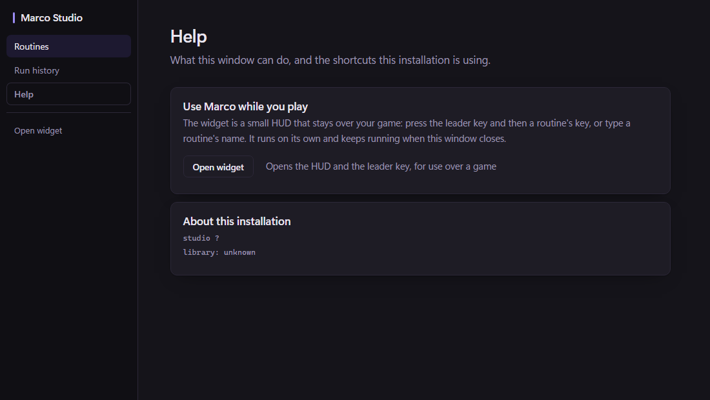
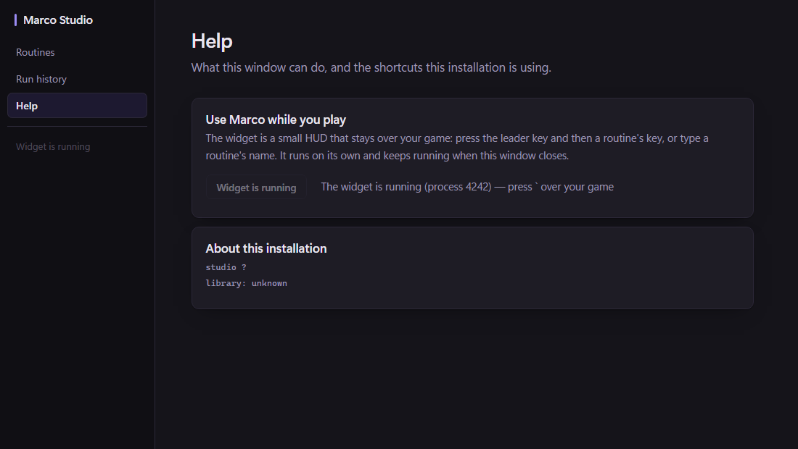
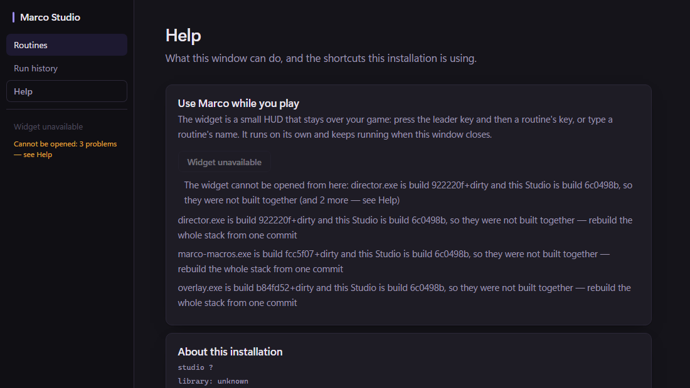
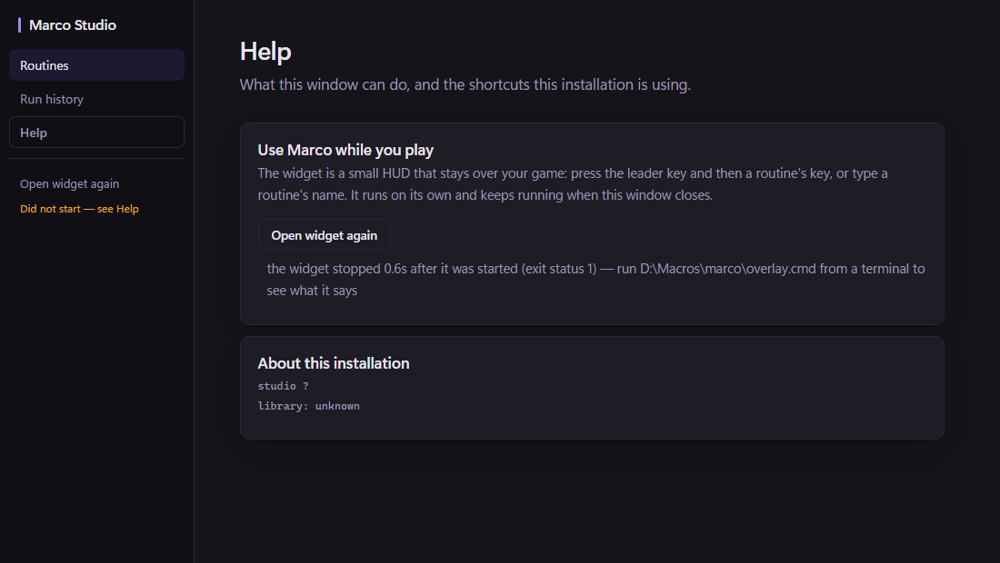

# Studio opens the widget

The proposal's "Start the widget from Studio (R5)", run as S7 by the owner's renumbering. It is §5.7
of [[Surfaces-alignment-proposal-2026-11-02]].

## The trace

Before building anything, I traced how the widget is started today.

- **Installed:** `Marco.exe --overlay` (`plugins/marco-app` `runOverlay`). It runs `marco.exe serve
  --host OS=bridge:marco-macros.exe --host Overlay=bridge:overlay.exe overlay.marco` from
  `%LOCALAPPDATA%\Marco\bin`, with `MARCO_BIN` set to that `marco.exe` and nothing about the
  library.
- **Tree:** `overlay.cmd` at the root runs the same `serve` with the overlay under
  `plugins\overlay`, and pipes the voice plugin into it.
- With bridge hosts present, `serve` does not end when its stdin does (`internal/driver`
  `mergeSources`). A child given no stdin therefore keeps running.
- The installer is its own module, named `marco-app`, and Go's internal rule keeps it from
  importing an engine package. Its command therefore stays where it is. `internal/widgetstack`
  `Args` is the same command for a layout, and `TestTheStackIsTheOneTheInstallerStarts` reads the
  installer's source and fails if the two drift.
- **What the root binaries carry, read with `go version -m` (nothing was run):**
  - `marco.exe` and `studio.exe` are `6c0498b`;
  - `director.exe` is `922220f+dirty`;
  - `marco-macros.exe` is `fcc5f07+dirty`;
  - `overlay.exe` is `b84fd52+dirty`.

  The mismatch is in the stamps, not only in the file times.

## What was decided

- **A secondary action, discoverable.** It sits in the rail, below the destinations and quieter
  than them, and again in Help in a card that says what the widget is. The button's label is the
  state. The line under it in the rail appears only when something is wrong, and Help lists every
  problem with what to do. Every word comes from the backend.
- **The installer's stack, beside this Studio** (`widgetstack.Beside`). That is the directory
  Studio already spawns `marco.exe` and `director.exe` from, so the widget performs with the
  engine Studio plays with. There are two layouts:
  - **installed:** every piece flat;
  - **tree:** the overlay under `plugins\overlay`.
- **What the child is given.** Studio's environment, plus three variables, each stated once:
  `MARCO_BIN` (the marco beside it, as the installer sets it), `MARCO_HOME` and `MARCO_ROUTES`
  (Studio's own, already absolute from `internal/marcopaths`). The widget therefore uses the same
  library and store as Studio, and reads the same `overlay.json`, because `MARCO_OVERLAY_CONFIG`
  is inherited.
  - Nothing about the application in front is passed: the widget reads it itself, at each press.
  - The console is hidden (`hideConsole`), so no window takes the foreground.
  - The child's stdout and stderr go nowhere. Studio keeps none of the widget's output, so
    nothing typed into it is written anywhere by this.
- **Never two.** A running Marco widget, from this installation or any other, is reused and said:
  *The widget is running (process N) — press ` over your game*, with where it is from when it is
  not this installation's. Here "a Marco widget" means an `overlay.exe` with `overlay.marco`
  beside it, so an unrelated `overlay.exe` is not taken for one. A launch this window has in
  progress is not repeated.
- **Never mixed.** Every piece must exist, and every Go program among them must carry the same
  KNOWN revision as this Studio (`buildid.Of`, read from the file with `debug/buildinfo`, never by
  running it). A piece with no stamp cannot be vouched for and is refused like a different one.
  This is what keeps the root stack blocked. The check is asked again after a failed launch, so a
  retry over a piece that has since changed is refused too.
- **The states:**

  | State | Meaning |
  |---|---|
  | ready | It can be opened. |
  | starting | Started, and inside the first four seconds. |
  | running | A widget is up, whoever started it. |
  | unavailable | Each missing or mismatched piece is named. |
  | failed | The start was refused, or the stack ended inside four seconds. It names the exit and the launcher to run from a terminal to see why. It may be tried again. |

  A widget closed after it was up is not a failure: the action is ready again.

## Renders

These are renders of the real page in headless Edge, with the backend stubbed: `window.go` answers
each state. They are the page's own layout and text, not a desktop run.

| ready | running |
|---|---|
|  |  |
| **unavailable** (this tree's root stack) | **failed** |
|  |  |

## Enforced by

- `plugins/studio`: `TestTheWidgetIsOpenedAsTheInstallerOpensIt`, `TestTheWidgetIsNeverStartedTwice`,
  `TestTheWidgetIsOnlyOpenedWhenItCanBe`, `TestALaunchThatFailedSaysSo`,
  `TestAWidgetClosedLaterIsReadyAgain`, `TestTheTreeLayoutIsOpenedFromItsOwnPlaces`,
  `TestAFailedLaunchIsNotRetriedOverAMismatch`, and `TestEveryMethodThePageCallsIsOnTheBackend` for
  the page's two calls. Every outward act is a seam:
  - the directory beside, filled with stand-in files;
  - the process list;
  - the start and the wait;
  - each file's revision.

  No test starts a process.
- `internal/widgetstack`: `TestTheStackIsFoundWhereEachLayoutPutsIt`,
  `TestTheStackIsTheOneTheInstallerStarts`, `TestAnOverlayIsOneWithItsProgramBesideIt`.

Mutations: 13 runs, all killed. In Studio:
- the running-widget check;
- the in-progress check;
- the problem check on a retry *(survived first; `TestAFailedLaunchIsNotRetriedOverAMismatch`
  added)*;
- `Same` relaxed to `Differ`, which would let unstamped pieces through;
- the child's environment;
- the early-exit window;
- taking any `overlay.exe` for a widget;
- the working directory;
- keeping the widget's output;
- the missing-piece check.

In the stack package:
- the host order against the installer's;
- recognising an overlay with no program beside it.

## Checks

Windows only, the affected checks. Passed: `go build ./...`; `buildid`, `widgetstack`, `gate`,
`wiringcheck` and `spectest`; gofmt; docscheck. Binary timestamps unchanged.

The whole Studio package went through three runs:

1. **The first run FAILED 15 page tests.** Studio's page harnesses render the real page in
   headless Edge, and treat any backend call their stub does not answer as a thrown page. That is
   the convention, and it is what caught this: the page now polls `WidgetStatus` from start-up.
2. Each harness, 21 files plus `testdata/shortcutspage.js`, gained a `WidgetStatus` answer. The
   page was not given a guard, which would have hidden a missing binding. The second run left one
   failure, the harness kept as a JS file, which had been missed.
3. The third run passed.

All three outputs are kept in `docs/experiments/Roadmap-38-output/`:
`2026-11-03-s7-{engine,studio,studio-after-stubs,studio-final}.txt`.

## Not established

- **Nothing was launched**, by instruction. The command, the environment, the hidden console and
  the four-second window were not exercised against a real stack. No rebuild was done, so the
  binaries beside this tree are still the mismatched ones, and Studio would show the widget as
  unavailable here.
- **Voice is not started.** The installer's stack has no voice plugin. The tree's `overlay.cmd`
  pipes one in, and Studio's launch does not.
- The widget is not brought forward or shown when it is already running: there is no channel to it
  for that. Studio says it is running and which leader to press.
- "A Marco widget is running" is any `overlay.exe` with `overlay.marco` beside it. One started
  from a stack Studio did not start is reported but not adopted: closing Studio leaves it, and the
  four-second failure window applies only to one Studio started.
- The revision check needs every piece built from one commit. In a development tree that is a
  whole rebuild: `marco-macros.exe` and `overlay.exe` are rarely rebuilt, and they block the action
  until they are.
- F6 (one meaning for Enter) and Roadmap 38 remain open and are unchanged, as is the
  binary-mismatch warning.
