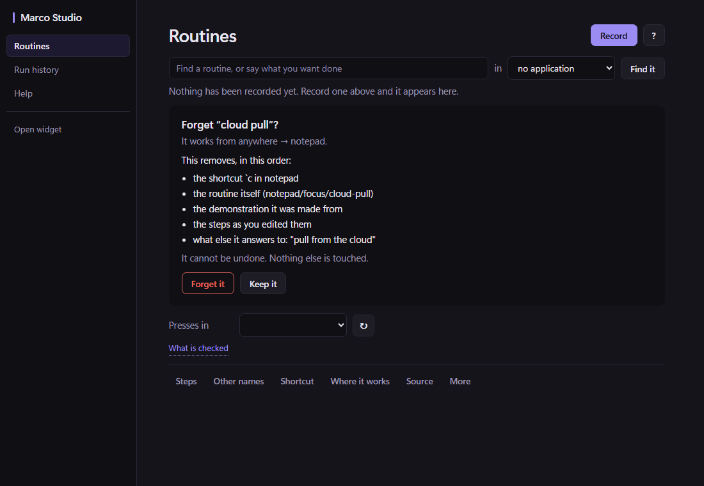
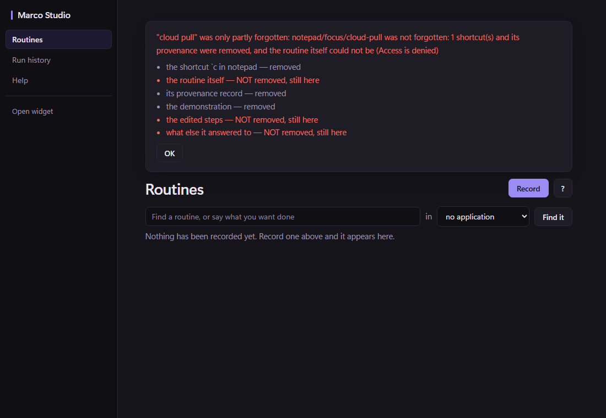

# Studio forgets one routine

R8 of [[Surfaces-alignment-proposal-2026-11-02]] (§5.5), part of S8 in the owner's numbering.

## What was decided

- **The one forget.** The CLI's `marco forget` and Forget-everything already go through
  `orchestrator.ForgetRoutine`: shortcuts first, then the provenance, then the routine and
  everything kept beside it, under the routine's lock. One routine from Studio goes through the
  same body. `ForgetAsPlanned` adds a single check in it: the plan's seal is recomputed under the
  lock, and anything different refuses with nothing removed. The seal covers the source, the
  demonstration, each shortcut and the phrases. So a shortcut assigned, or a save, after somebody
  read the list is never removed unseen.
- **Not the Forget-everything card.** This is its own confirmation:
  - *Forget "cloud pull"?*, and where it works;
  - *This removes, in this order:*, then each part that exists, named;
  - *It cannot be undone. Nothing else is touched.*;
  - **Forget it**, the button with the danger style, and **Keep it**.

  Parts that do not exist are not listed. A routine with no provenance record is not told one was
  removed. That was a real defect, and the first test run caught it: a refused forget read as
  "partly forgotten".
- **What happened is read, not assumed.** A forget that stops partway can leave any mix of its
  parts. The result is therefore each listed part read back off the disk, *removed* or *NOT
  removed, still here*, whether or not the forget reported success. It is shown in a card above the
  library, because the routine's own panel disappears with the routine. Three sentences are
  possible:
  - *Forgot "…" and everything listed.*
  - *"…" was only partly forgotten: <the forget's own reason>*
  - *Nothing was removed: <reason>*

## Renders

These are renders of the real page in headless Edge with the backend stubbed, not a desktop run.

| the confirmation | a partial forget |
|---|---|
|  |  |

## Enforced by

- `plugins/studio`: `TestForgettingOneRoutineIsWhatWasShown`, `TestAForgetOverAChangeRemovesNothing`,
  and, on Windows only, `TestAPartialForgetSaysWhatIsStillThere`. That last one holds the
  routine's source open, so the real forget stops at its last step after the shortcut and the
  demonstration have gone.
- `internal/orchestrator`: `TestAForgetAsPlannedRemovesWhatItShowed`, `TestAForgetRemovesNothingItDidNotShow`.

Mutations: 8 runs, 7 killed:

- forgetting without the seal;
- shortcuts always reported gone;
- the routine always reported gone;
- a review usable twice;
- provenance listed when there was none;
- the check under the lock removed;
- shortcuts left out of the seal (this pattern needed a second form to apply).

The survivor drops the read-back from the overall `Removed` flag. It is redundant today, because
`ForgetRoutine` reports success only when every part is gone. It is kept as the second reading the
result is built on, and recorded here rather than tested.

## Not established

- **No desktop run.** The button's place on a real routine row was rendered only with an empty
  library around it.
- Windows only.
- Anchor images are removed without being reported, as `Registry.Delete` does.
- Staged learned routines of the same name are untouched, as the CLI's forget leaves them.
